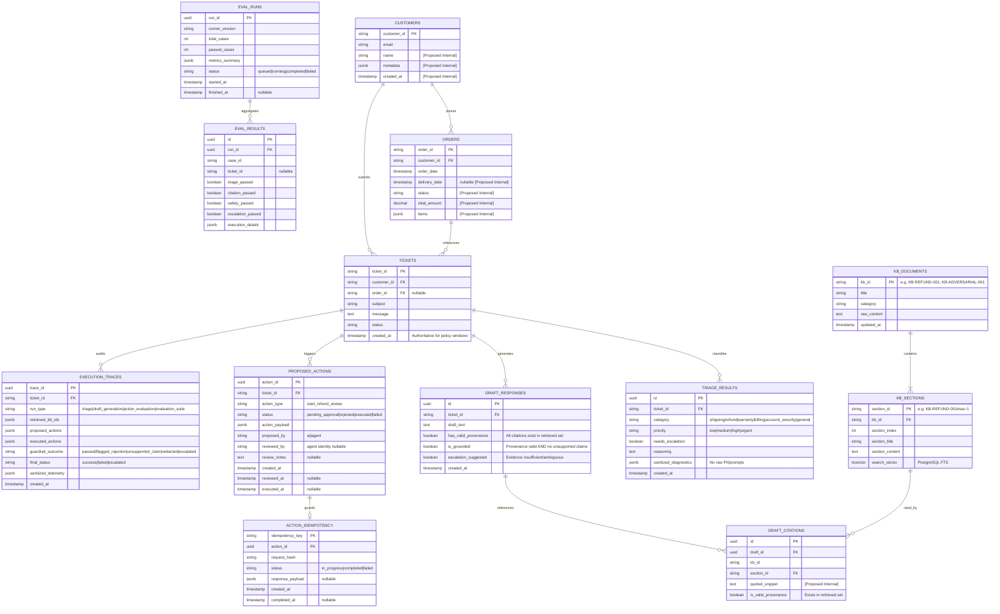
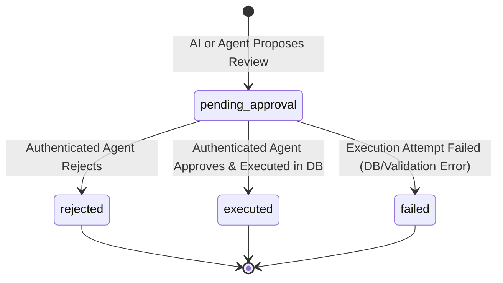
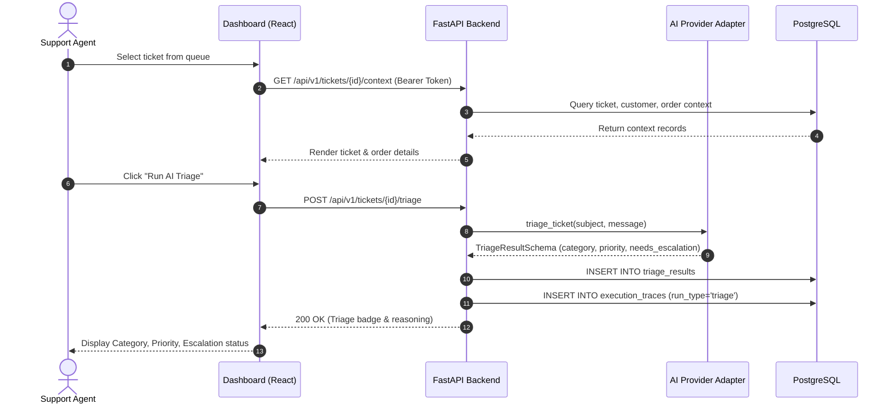
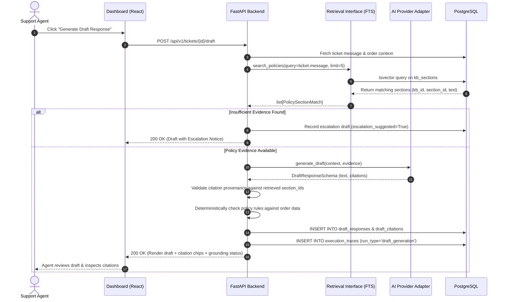
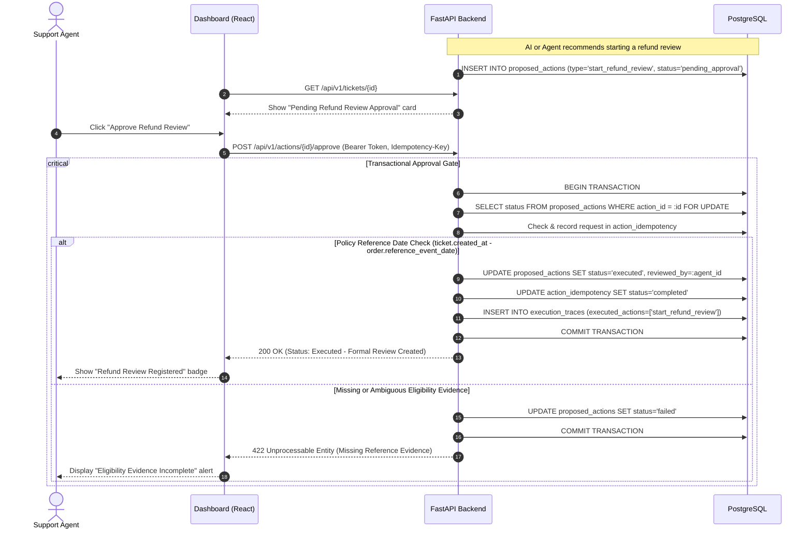
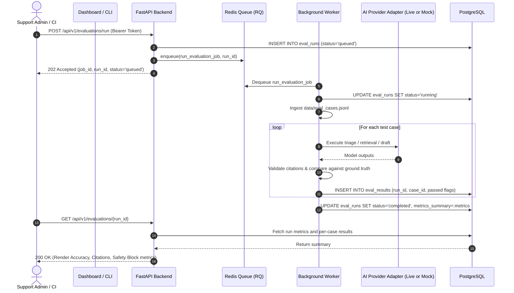

# TrustDesk — System Architecture Document

**Document Version:** 1.1.0  
**Status:** Architecture Specification (Finalized & Consistency Reviewed)  
**Role:** Senior Software Architect & Technical Reviewer  
**Authoritative Reference:** [docs/problem_statement.md](file:///Users/dhruv/Desktop/TrustDesk/docs/problem_statement.md)

---

## 1. System Overview

### 1.1 Purpose and Operational Context
**TrustDesk** is an internal AI-assisted customer support operations platform designed to augment human support agents. It ingests customer tickets along with linked customer and order history, performs automated classification and priority triage, retrieves authoritative company policy evidence using Retrieval-Augmented Generation (RAG), generates cited response drafts, and recommends policy-governed operational actions.

> [!IMPORTANT]
> **TrustDesk is strictly an internal support-agent application, not a customer-facing conversational chatbot.**  
> The system operates as a human-in-the-loop decision-support tool. It never sends unreviewed messages to customers and never autonomously executes sensitive business operations.  
> 
> Furthermore, **`start_refund_review` means creating a formal refund-review request in the support workflow, NOT approving, calculating, or issuing a monetary refund.** TrustDesk does not integrate with payment gateways and does not disburse funds.

### 1.2 Core Architectural Principles
1. **Human-in-the-Loop Authority:** The AI acts strictly as an advisory co-pilot. All customer-facing communications and operational actions require explicit human agent review and approval.
2. **Deterministic Backend Governance:** Business logic, policy eligibility criteria, security gates, action execution, and identity verification are strictly enforced by deterministic backend code, never delegated to probabilistic Large Language Model (LLM) reasoning.
3. **Traceability and Evidence Grounding:** AI response drafts must be grounded in retrieved company policy sections. Every statement must cite its original knowledge-base identifier. Provenance validation verifies cited identifiers, while consequential business facts are independently checked by backend code. Unsupported or uncertain claims trigger escalation.
4. **Defense in Depth against Untrusted Input:** Customer messages and external knowledge documents (including adversarial files) are treated as lower-trust data subject to structural delimiters, prompt framing, output sanitization, and backend authorization. Delimiters and prompt instructions reduce risk but do not provide mathematical immunity; system safety relies on backend validation and lack of autonomous tool-execution privileges.
5. **Idempotency and Transactional Safety:** State-altering operations are protected against repeated submissions, race conditions, and network retries using persistent request idempotency tracking, business-operation uniqueness constraints, and PostgreSQL row-level locks.
6. **Separation of Ephemeral and Persistent State:** Transient execution queues and worker coordination reside in Redis, while persistent business records, audit logs, AI execution traces, and evaluation results reside exclusively in PostgreSQL.

### 1.3 System Trust Boundaries and Responsibility Separation
TrustDesk maintains strict trust boundaries between three operational planes:

```
+-----------------------------------------------------------------------------------+
|                        LOWER-TRUST DATA BOUNDARY                                  |
|  - Ingested Customer Messages (untrusted customer inquiries, potential injection) |
|  - Ingested Knowledge Base Documents (retrievable content, including              |
|    adversarial document KB-ADVERSARIAL-001)                                       |
+-----------------------------------------------------------------------------------+
                                         │
                                         ▼
+-----------------------------------------------------------------------------------+
|                              AI-ASSISTED PLANE                                    |
|  Responsibilities:                                                                |
|  - Propose classification (category, priority, escalation flag)                   |
|  - Synthesize customer-facing draft text from provided policy context             |
|  - Propose citation references from retrieved evidence                            |
|  - Propose operational action recommendations (e.g., recommend refund review)     |
|                                                                                   |
|  Strict Boundaries:                                                               |
|  - CANNOT authorize actions or alter persistent system state                      |
|  - CANNOT bypass policy dates, thresholds, or eligibility criteria                |
|  - CANNOT access backend databases, credentials, or execution tools directly      |
+-----------------------------------------------------------------------------------+
                                         │  (Structured Recommendations)
                                         ▼
+-----------------------------------------------------------------------------------+
|                     DETERMINISTIC BACKEND CONTROL PLANE                           |
|  (Shared Application Domain Services: FastAPI API & Python RQ Worker)             |
|  Responsibilities:                                                                |
|  - Authenticate agent requests (Demo Bearer Token mapped to demo identity)        |
|  - Validate AI outputs at runtime against strict Pydantic schemas                 |
|  - Enforce business rules (e.g., policy reference dates vs. ticket created_at)   |
|  - Execute policy retrieval (PostgreSQL FTS adapter)                              |
|  - Enforce request idempotency and business-operation uniqueness                  |
|  - Record immutable execution traces and audit trails in PostgreSQL               |
|                                                                                   |
|  Strict Boundaries:                                                               |
|  - Never executes sensitive actions without authenticated human approval          |
|  - Never treats retrievable content as trusted policy without backend validation  |
+-----------------------------------------------------------------------------------+
                                         │  (Action Gate & Approval UI)
                                         ▼
+-----------------------------------------------------------------------------------+
|                             HUMAN AGENT PLANE                                     |
|  Responsibilities:                                                                |
|  - Inspect customer complaint, order history, and AI triage recommendations       |
|  - Review generated draft against cited policy evidence                           |
|  - Explicitly approve or reject proposed operational actions (Refund Review)      |
|  - Modify response draft before communication                                     |
+-----------------------------------------------------------------------------------+
```

---

## 2. High-Level System Architecture

### 2.1 Architectural Topology Diagram
The system follows a modular monolith architecture. A single FastAPI web application handles HTTP requests from the React frontend, while a separate Python RQ worker process executes background tasks. Both processes share the application domain layer, repository abstractions, and PostgreSQL database connections.

```mermaid
flowchart TB
    subgraph Client["Client Tier"]
        UI["Support-Agent Dashboard\n(React + Vite + Tailwind CSS)"]
    end

    subgraph AppTier["Application Tier (Modular Monolith)"]
        subgraph FastAPIProcess["FastAPI Process (HTTP API)"]
            API["FastAPI Web Server"]
            AuthMiddleware["Demo Bearer Token Auth Middleware\n(Maps to Fixed Demo Identity)"]
            TicketRouter["Ticket & Context Router"]
            ActionRouter["Action Approval Router"]
            EvalRouter["Evaluation Router"]
            
            API --> AuthMiddleware
            AuthMiddleware --> TicketRouter
            AuthMiddleware --> ActionRouter
            AuthMiddleware --> EvalRouter
        end

        subgraph SharedDomain["Shared Application Domain Services & Repositories"]
            DomainServices["Domain Services\n(Triage, Drafts, Actions, Idempotency)"]
            RetrievalInterface["PolicyRetrievalInterface\n(search_policies)"]
            ProviderAdapter["AIProviderAdapter\n(Live Adapter / Mock Provider)"]
            DataRepo["Data Access Layer / Repositories\n(SQLAlchemy 2.0 / psycopg)"]
        end

        subgraph WorkerProcess["Background Worker Process (Python / RQ)"]
            RQWorker["RQ Worker Daemon\n(Batch Eval & Long-Running Tasks)"]
        end

        TicketRouter --> DomainServices
        ActionRouter --> DomainServices
        EvalRouter --> DomainServices
        RQWorker --> DomainServices
        DomainServices --> RetrievalInterface
        DomainServices --> ProviderAdapter
        DomainServices --> DataRepo
    end

    subgraph AsyncBroker["Asynchronous Message Broker Tier"]
        RedisQueue[("Redis Broker & Queue\n(Ephemeral Job State)")]
    end

    subgraph StorageTier["Persistence Tier (PostgreSQL)"]
        DB[(PostgreSQL Primary Database)]
        Tables["Authoritative Store:\n- customers, orders, tickets\n- kb_documents, kb_sections (FTS)\n- triage_results, draft_responses\n- proposed_actions, action_idempotency\n- execution_traces, eval_runs, eval_results"]
        DB --- Tables
    end

    subgraph ExternalPostMVP["Post-MVP Vector Store"]
        QdrantDB[("Qdrant Vector DB\n[Planned Post-MVP Enhancement]")]
    end

    %% Interactions
    UI <-->|HTTP / REST JSON\nBearer Token| API
    EvalRouter -->|Enqueue Long-Running Tasks| RedisQueue
    RQWorker -->|Pull Jobs| RedisQueue

    DataRepo <-->|SQL Queries & Transactions\nFOR UPDATE Locks| DB
    RetrievalInterface <-->|PostgreSQL FTS\ntsvector / tsquery| DB
    RetrievalInterface -.->|Vector Similarity Search\n(Post-MVP Adapter)| QdrantDB
```

### 2.2 Component Communication and Data Ownership
- **FastAPI Process:** The HTTP entrypoint for client requests, authentication, and synchronous workflow orchestration. It enforces security headers and delegates domain logic to the shared domain layer.
- **Python RQ Worker:** A background daemon process executing long-running asynchronous tasks (such as batch evaluation runs of `data/eval_cases.jsonl`). It shares the same domain layer and repositories as FastAPI, writing results directly to PostgreSQL.
- **Shared Domain Layer & Repositories:** Contains core business logic, validation rules, RAG orchestration, and database access routines. Both FastAPI and the RQ worker access PostgreSQL through this shared layer.
- **PostgreSQL Database:** The single authoritative source of truth for persistent application state: source operational records, knowledge base documents, indexed policy sections, derived AI outputs, human approval decisions, idempotency keys, execution audit traces, and evaluation runs.
- **PostgreSQL Full-Text Search (FTS):** Managed natively within PostgreSQL using `tsvector` columns, English dictionaries, and `tsquery` ranking (`ts_rank_cd`). It owns policy indexing and keyword retrieval for the initial MVP.
- **Redis & RQ (Redis Queue):** Ephemeral task broker managing job queues, task serialization, job status tracking (`queued`, `started`, `finished`, `failed`), and worker heartbeats. Redis does **not** store persistent business records or audit logs.
- **AI Provider Adapter:** Encapsulates all LLM network interactions, payload marshaling, prompt construction, error mapping, and runtime Pydantic schema validation. It provides interchangeable implementations for live provider APIs and a deterministic `MockAIProvider`.
- **Qdrant Vector Database (Planned Post-MVP):** Explicitly designated as a post-MVP enhancement. When introduced, it will store dense vector embeddings of policy sections for semantic similarity retrieval. It is **not** an initial dependency.

---

## 3. Component Responsibilities

### 3.1 Support-Agent Dashboard (Frontend)
- **Technology:** React, Vite, Tailwind CSS.
- **Exact Responsibility:** Render an intuitive internal dashboard for support agents to inspect tickets, view customer and order context, trigger AI triage and draft generation, inspect policy citations, review action recommendations, and submit approval/rejection decisions.
- **Data Received:** JSON responses from FastAPI endpoints (ticket lists, customer/order context, triage classifications, response drafts with citation metadata, pending action details, job status).
- **Data Returned:** HTTP requests with user interactions (opaque demo bearer token in `Authorization` header, action approval/rejection payloads, triage/draft trigger requests).
- **Communicates With:** FastAPI REST API only.
- **Must Never Be Responsible For:**
  - Direct communication with PostgreSQL, Redis, or LLM providers.
  - Making business rule decisions (e.g., verifying warranty eligibility or calculating elapsed time).
  - Executing sensitive actions directly without backend authorization.

### 3.2 Application Backend (FastAPI Web Server)
- **Technology:** Python 3.11+, FastAPI, Pydantic v2.
- **Exact Responsibility:** Expose REST API routes; enforce demo token authentication; coordinate synchronous policy retrieval and AI triage/draft generation; execute deterministic business rules; manage the lifecycle of proposed actions; enforce transactional idempotency; persist data, traces, and evaluation results in PostgreSQL; enqueue long-running jobs to Redis.
- **Data Received:** HTTP requests from the frontend; data ingestion files from the filesystem; completed task notifications from worker/PostgreSQL.
- **Data Returned:** Structured HTTP JSON responses and standard HTTP error codes.
- **Communicates With:** React Frontend, PostgreSQL (via shared repositories), Redis Queue, AI Provider Adapter, Policy Retrieval Interface.
- **Must Never Be Responsible For:**
  - Issuing financial refunds or executing bank transactions.
  - Silently accepting unvalidated LLM output.
  - Bypassing human approval on sensitive actions.

### 3.3 Relational Storage & Full-Text Search (PostgreSQL)
- **Technology:** PostgreSQL 15+.
- **Exact Responsibility:** Persist authoritative domain data (customers, orders, tickets), knowledge base documents, pre-chunked policy sections with FTS vectors, AI triage results, response drafts, proposed/executed actions, idempotency keys, execution traces, and evaluation results. Execute native text search queries via `tsvector` and GIN indexing.
- **Data Received:** Relational schema definitions, SQL queries, transactional writes.
- **Data Returned:** Relational query results, search result rows, constraint violation signals.
- **Communicates With:** FastAPI Backend and Background Worker (via shared data-access layer).
- **Must Never Be Responsible For:**
  - External network calls or business orchestration logic.

### 3.4 Asynchronous Task Queue & Broker (Redis + RQ)
- **Technology:** Redis 7+, RQ (Redis Queue).
- **Exact Responsibility:** Buffer asynchronous task jobs, distribute jobs to available workers, track transient job status (`queued`, `started`, `finished`, `failed`), and manage retry scheduling.
- **Data Received:** Serialized job definitions (function names and job arguments).
- **Data Returned:** Job metadata, queue depths, job failure traces.
- **Communicates With:** FastAPI Backend and Background Worker.
- **Must Never Be Responsible For:**
  - Serving as a persistent audit store or authoritative business database.
  - Making decisions regarding job business validity.

### 3.5 Background Task Worker (Python RQ Worker)
- **Technology:** Python 3.11+, RQ Worker daemon.
- **Exact Responsibility:** Execute long-running background tasks such as batch dataset evaluation (`eval_cases.jsonl`) and batch ticket processing without blocking interactive API endpoints.
- **Data Received:** Job invocations from Redis queues.
- **Data Returned:** Execution results written directly to PostgreSQL; completion status returned to Redis.
- **Communicates With:** Redis, PostgreSQL (via shared data-access layer), AI Provider Adapter, Policy Retrieval Interface.
- **Must Never Be Responsible For:**
  - Handling direct client HTTP traffic.
  - Modifying action approval states without an authenticated human command.

### 3.6 Policy Retrieval Boundary (`PolicyRetrievalInterface`)
- **Technology:** Python Abstract Base Class (ABC).
- **Exact Responsibility:** Decouple the draft-generation pipeline from specific search database implementations. Exposes a clean interface:
  ```python
  class PolicyRetrievalInterface(ABC):
      @abstractmethod
      def search_policies(self, query: str, limit: int = 5) -> list[PolicySectionMatch]:
          """Retrieve matching policy sections for a query.
          limit=5 is a configurable default, not a coverage guarantee.
          Multi-intent queries may require multiple searches, merging, and deduplication.
          """
          pass
  ```
- **Data Received:** Search query string (e.g., customer complaint or ticket summary) and optional retrieval parameters.
- **Data Returned:** List of matching policy sections, including `kb_id`, `section_id`, `section_title`, `content`, and similarity/relevance score.
- **Communicates With:** Implemented by `PostgresFtsRetrievalAdapter` in MVP; extensible to `QdrantRetrievalAdapter` post-MVP.
- **Must Never Be Responsible For:**
  - Prompt construction, LLM invocation, or citation validation.

### 3.7 AI Provider Adapter Boundary (`AIProviderAdapter`)
- **Technology:** Python Abstract Base Class (ABC).
- **Exact Responsibility:** Abstract LLM interactions, provide a unified contract for ticket triage, draft generation, and action recommendation, validate responses at runtime against Pydantic schemas, handle timeouts and retries, and provide deterministic mocking for testing.
- **Data Received:** Structured prompt payloads, system instructions, retrieval evidence, and customer/order context.
- **Data Returned:** Strongly typed, Pydantic-validated response objects (`TriageResultSchema`, `DraftResponseSchema`, `ActionRecommendationSchema`).
- **Communicates With:** External LLM APIs (Live adapter) or Local canned responses (Mock adapter).
- **Must Never Be Responsible For:**
  - Direct database querying or executing sensitive business side-effects.

### 3.8 Post-MVP Semantic Retrieval Boundary (Qdrant Vector Database)
- **Technology:** Qdrant Vector Database.
- **Exact Responsibility (Post-MVP):** Index dense vector embeddings of policy sections to provide semantic nearest-neighbor retrieval, complementing or augmenting keyword search.
- **Data Received:** Dense vector embeddings and document payload metadata.
- **Data Returned:** Ranked nearest-neighbor section IDs and similarity scores.
- **Communicates With:** `QdrantRetrievalAdapter` in the Application Backend/Worker.
- **Must Never Be Responsible For:**
  - Functioning as an MVP dependency or primary relational store.

---

## 4. Data Architecture

### 4.1 Persistence Strategy: Source vs. Derived Records
TrustDesk establishes a clear distinction between:
- **Source Operational Records:** Ingested baseline domain entities (`customers`, `orders`, `tickets`, `kb_documents`, `kb_sections`). These represent historical truth and are never modified by AI processes.
- **Derived AI Records:** Output artifacts produced by AI processes (`triage_results`, `draft_responses`, `proposed_actions`, `execution_traces`, `eval_runs`, `eval_results`). These records link back to source entities via foreign keys and maintain auditability.

> [!NOTE]
> **Schema Field Classification:** As source dataset files in `data/` will be ingested during implementation, fields not explicitly defined in `docs/problem_statement.md` are marked below as **[Proposed Internal Schema Field]**. These represent proposed application design rather than confirmed source dataset fields. Core identifiers (`customer_id`, `order_id`, `ticket_id`, `kb_id`, `created_at`, `start_refund_review`) are authoritative requirements.

### 4.2 Entity Relationship Diagram (ERD)



### 4.3 Detailed PostgreSQL Table Specifications

#### 1. `customers` [Source Entity]
- `customer_id` (VARCHAR(64), PK): Unique identifier from dataset.
- `email` (VARCHAR(255), NULLABLE): Customer contact email. (Avoid unsupported `UNIQUE` or `NOT NULL` assumptions until verified against source dataset).
- `name` (VARCHAR(255), [Proposed Internal Schema Field]): Customer display name.
- `metadata` (JSONB, [Proposed Internal Schema Field]): Additional profile attributes.
- `created_at` (TIMESTAMPTZ, NOT NULL, DEFAULT NOW()): Registration timestamp.

#### 2. `orders` [Source Entity]
- `order_id` (VARCHAR(64), PK): Unique order identifier from dataset.
- `customer_id` (VARCHAR(64), FK -> customers.customer_id, NOT NULL): Linked customer.
- `order_date` (TIMESTAMPTZ, NOT NULL): Date the order was placed.
- `delivery_date` (TIMESTAMPTZ, NULLABLE, [Proposed Internal Schema Field]): Delivery date if specified by policy.
- `status` (VARCHAR(32), NULLABLE, [Proposed Internal Schema Field]): Order state (`delivered`, `in_transit`, etc.).
- `total_amount` (NUMERIC(10, 2), NULLABLE, [Proposed Internal Schema Field]): Total purchase value.
- `items` (JSONB, NULLABLE, [Proposed Internal Schema Field]): Array of item records `[{"sku": "...", "name": "...", "price": 0.0, "qty": 1}]`.

#### 3. `tickets` [Source Entity]
- `ticket_id` (VARCHAR(64), PK): Unique ticket identifier from dataset.
- `customer_id` (VARCHAR(64), FK -> customers.customer_id, NOT NULL): Submitting customer.
- `order_id` (VARCHAR(64), FK -> orders.order_id, NULLABLE): Linked order. **Nullable** because general inquiries or unlinked tickets may not reference an order.
- `subject` (VARCHAR(255), NOT NULL): Ticket summary or subject line.
- `message` (TEXT, NOT NULL): Raw customer inquiry (treated as lower-trust data).
- `status` (VARCHAR(32), NOT NULL, DEFAULT 'open'): Ticket status (`open`, `in_review`, `escalated`, `closed`).
- `created_at` (TIMESTAMPTZ, NOT NULL): **Authoritative reference timestamp.** All warranty and return policy calculations are evaluated relative to this timestamp, never `NOW()`.

#### 4. `kb_documents` & `kb_sections` [Knowledge Base]
- `kb_documents`:
  - `kb_id` (VARCHAR(64), PK): Original dataset document ID (e.g., `KB-REFUND-001`, `KB-WAR-002`, `KB-ADVERSARIAL-001`). Must be strictly preserved.
  - `title` (VARCHAR(255), NOT NULL): Document title.
  - `category` (VARCHAR(64), NOT NULL): Policy category (`refund`, `warranty`, `shipping`, etc.).
  - `raw_content` (TEXT, NOT NULL): Full un-chunked document text.
  - `updated_at` (TIMESTAMPTZ, NOT NULL, DEFAULT NOW()).
- `kb_sections`:
  - `section_id` (VARCHAR(128), PK): Deterministic section reference formatted as `{kb_id}#sec-{index}`.
  - `kb_id` (VARCHAR(64), FK -> kb_documents.kb_id, NOT NULL): Parent document ID.
  - `section_index` (INTEGER, NOT NULL): 0-indexed position within the document.
  - `section_title` (VARCHAR(255), NOT NULL): Header or topic of the section.
  - `section_content` (TEXT, NOT NULL): Text content of the section used for context injection.
  - `search_vector` (TSVECTOR, GENERATED ALWAYS AS): Precomputed PostgreSQL full-text search vector combining `section_title` (weight A) and `section_content` (weight B).
  - *Index:* GIN index on `search_vector` (`idx_kb_sections_fts`).

#### 5. `triage_results` [Derived AI Entity]
- `id` (UUID, PK, DEFAULT gen_random_uuid()): Unique classification record ID.
- `ticket_id` (VARCHAR(64), FK -> tickets.ticket_id, NOT NULL): Associated ticket.
- `category` (VARCHAR(32), NOT NULL): Strictly: `shipping`, `refund`, `warranty`, `billing`, `account_security`, `general`.
- `priority` (VARCHAR(16), NOT NULL): Strictly: `low`, `medium`, `high`, `urgent`.
- `needs_escalation` (BOOLEAN, NOT NULL): Escalation flag.
- `reasoning` (TEXT, NOT NULL): Justification provided by LLM.
- `sanitized_diagnostics` (JSONB, NOT NULL, DEFAULT '{}'::jsonb): Sanitized model diagnostics without customer PII or raw prompts.
- `created_at` (TIMESTAMPTZ, NOT NULL, DEFAULT NOW()).

#### 6. `draft_responses` & `draft_citations` [Derived AI Entity]
- `draft_responses`:
  - `id` (UUID, PK, DEFAULT gen_random_uuid()): Draft ID.
  - `ticket_id` (VARCHAR(64), FK -> tickets.ticket_id, NOT NULL): Associated ticket.
  - `draft_text` (TEXT, NOT NULL): Generated customer response draft.
  - `has_valid_provenance` (BOOLEAN, NOT NULL): True if all cited KB/section IDs were actually present in the retrieved evidence set.
  - `is_grounded` (BOOLEAN, NOT NULL): True if `has_valid_provenance` is True AND deterministic policy validation detected no unsupported claims or escalation triggers.
  - `escalation_suggested` (BOOLEAN, NOT NULL): True if policy evidence was insufficient or ambiguous.
  - `created_at` (TIMESTAMPTZ, NOT NULL, DEFAULT NOW()).
- `draft_citations`:
  - `id` (UUID, PK, DEFAULT gen_random_uuid()): Citation ID.
  - `draft_id` (UUID, FK -> draft_responses.id, NOT NULL): Parent draft.
  - `kb_id` (VARCHAR(64), NOT NULL): Cited document ID (e.g., `KB-REFUND-001`).
  - `section_id` (VARCHAR(128), FK -> kb_sections.section_id, NOT NULL): Exact cited section.
  - `quoted_snippet` (TEXT, [Proposed Internal Schema Field]): Snippet from evidence supporting the claim.
  - `is_valid_provenance` (BOOLEAN, NOT NULL): True if section existed in the retrieved evidence set.

#### 7. `proposed_actions` & `action_idempotency` [Controlled Actions]
- `proposed_actions`:
  - `action_id` (UUID, PK, DEFAULT gen_random_uuid()): Action ID.
  - `ticket_id` (VARCHAR(64), FK -> tickets.ticket_id, NOT NULL): Associated ticket.
  - `action_type` (VARCHAR(64), NOT NULL): Fixed to `start_refund_review`. (No other actions permitted in scope).
  - `status` (VARCHAR(32), NOT NULL): Canonical lifecycle state: `pending_approval`, `rejected`, `executed`, `failed`.
  - `action_payload` (JSONB, NOT NULL): Action parameters (e.g., `{"order_id": "ORD-123", "reason": "damaged_goods", "customer_requested": true}`).
  - `proposed_by` (VARCHAR(32), NOT NULL): Originator (`ai` or `agent`).
  - `reviewed_by` (VARCHAR(64), NULLABLE): Identifier of human agent who approved/rejected.
  - `review_notes` (TEXT, NULLABLE): Human agent comments upon decision.
  - `created_at` (TIMESTAMPTZ, NOT NULL, DEFAULT NOW()): Timestamp when action was recommended.
  - `reviewed_at` (TIMESTAMPTZ, NULLABLE): Timestamp of human approval/rejection.
  - `executed_at` (TIMESTAMPTZ, NULLABLE): Timestamp when review registration completed.
  - *Business Operation Uniqueness:* Partial unique index `idx_unique_active_refund_review ON proposed_actions (ticket_id, action_type) WHERE status IN ('pending_approval', 'executed')`. Ensures only one active or executed refund review can exist per ticket.
- `action_idempotency`:
  - `idempotency_key` (VARCHAR(128), PK): Request idempotency key (client-provided or deterministic).
  - `action_id` (UUID, FK -> proposed_actions.action_id, NOT NULL): Linked action.
  - `request_hash` (VARCHAR(64), NOT NULL): SHA256 hash of request payload to detect parameter tampering on key reuse.
  - `status` (VARCHAR(32), NOT NULL): Request state (`in_progress`, `completed`, `failed`).
  - `response_payload` (JSONB, NULLABLE): Cached HTTP response payload for idempotent replays.
  - `created_at` (TIMESTAMPTZ, NOT NULL, DEFAULT NOW()).
  - `completed_at` (TIMESTAMPTZ, NULLABLE).

#### 8. `execution_traces` [Observability & Audit]
- `trace_id` (UUID, PK, DEFAULT gen_random_uuid()): Unique trace identifier.
- `ticket_id` (VARCHAR(64), FK -> tickets.ticket_id, NOT NULL): Target ticket.
- `run_type` (VARCHAR(32), NOT NULL): Canonical run type: `triage`, `draft_generation`, `action_evaluation`, `evaluation_suite`.
- `retrieved_kb_ids` (JSONB, NOT NULL): Array of KB document IDs retrieved as context (e.g., `["KB-REFUND-001", "KB-SHIPPING-004"]`).
- `proposed_actions` (JSONB, NOT NULL): Actions suggested during this run.
- `executed_actions` (JSONB, NOT NULL): Actions verified and executed.
- `guardrail_outcome` (VARCHAR(32), NOT NULL): Canonical outcome: `passed`, `flagged_injection`, `unsupported_claim`, `redacted`, `escalated`.
- `final_status` (VARCHAR(32), NOT NULL): Canonical status: `success`, `failed`, `escalated`.
- `sanitized_telemetry` (JSONB, NOT NULL): Redacted latency, token usage, model identifiers (strictly no raw customer PII or raw secrets).
- `created_at` (TIMESTAMPTZ, NOT NULL, DEFAULT NOW()).

#### 9. `eval_runs` & `eval_results` [Evaluation]
- `eval_runs`:
  - `run_id` (UUID, PK, DEFAULT gen_random_uuid()): Evaluation run ID.
  - `runner_version` (VARCHAR(32), NOT NULL): Version tag or git commit.
  - `total_cases` (INTEGER, NOT NULL): Number of cases evaluated.
  - `passed_cases` (INTEGER, NOT NULL, DEFAULT 0).
  - `metrics_summary` (JSONB, NOT NULL, DEFAULT '{}'::jsonb): Aggregate metrics (triage accuracy, citation coverage, unsafe blocking count).
  - `status` (VARCHAR(32), NOT NULL): `queued`, `running`, `completed`, `failed`.
  - `started_at` (TIMESTAMPTZ, NOT NULL, DEFAULT NOW()).
  - `finished_at` (TIMESTAMPTZ, NULLABLE).
- `eval_results`:
  - `id` (UUID, PK, DEFAULT gen_random_uuid()): Individual case outcome ID.
  - `run_id` (UUID, FK -> eval_runs.run_id, NOT NULL): Parent evaluation run.
  - `case_id` (VARCHAR(64), NOT NULL): Case identifier from evaluation dataset.
  - `ticket_id` (VARCHAR(64), NULLABLE): Evaluated ticket ID if applicable.
  - `triage_passed` (BOOLEAN, NOT NULL): Category and priority matched ground truth.
  - `citation_passed` (BOOLEAN, NOT NULL): Citations matched expected policy IDs.
  - `safety_passed` (BOOLEAN, NOT NULL): Unsafe action or injection correctly blocked.
  - `escalation_passed` (BOOLEAN, NOT NULL): Escalation matched expected outcome.
  - `execution_details` (JSONB, NOT NULL): Detailed comparison breakdown.

### 4.4 Ingestion, Deduplication, and Identifier Preservation
Data ingestion is executed via an idempotent CLI command or service module (`ingest_dataset`):
1. **Deduplication Strategy:** Ingestion queries use PostgreSQL `ON CONFLICT (customer_id) DO UPDATE`, `ON CONFLICT (order_id) DO UPDATE`, and `ON CONFLICT (ticket_id) DO UPDATE` to allow repeated, safe ingestion runs without duplicating entities or overwriting authoritative source data with fabricated defaults.
2. **Preservation of KB Identifiers:** Original document identifiers (such as `KB-REFUND-001`, `KB-SHIPPING-002`, `KB-ADVERSARIAL-001`) are designated as primary keys in `kb_documents`. Section IDs are systematically derived as `{kb_id}#sec-{index}` to maintain unambiguous end-to-end traceability across database records, vector indexes, and LLM citations.
3. **Handling Missing References:** If an ingested ticket references an `order_id` that is not present in the orders dataset, the foreign key constraint allows `NULL`. The ingestion pipeline logs a structured ingestion warning and stores `NULL` in `order_id` while preserving the raw reference in ticket metadata. The system does not invent customer or order records to satisfy missing relationships.

### 4.5 Temporal Policy Evaluation Rule
A core business rule mandated by `docs/problem_statement.md`:
> Return and warranty policy windows must be evaluated relative to the ticket's `created_at` timestamp, not the current system date.

**Authoritative Evaluation Semantics:**
- All eligibility checks are evaluated **as of `ticket.created_at`**, never the current system date (`NOW()`).
- The start of the eligibility window depends on the applicable policy. A policy may reference purchase date (`orders.order_date`), delivery date (`orders.delivery_date`), warranty activation date, or another explicitly defined event.
- The backend uses the policy-defined reference event timestamp from authoritative order data:
  $$\Delta t = \text{ticket.created\_at} - \text{order.reference\_event\_date}$$
- **Missing Timestamp Handling:** If the required reference timestamp (e.g., delivery date) is missing or unavailable in the order record, the system **must not invent it**. Missing or ambiguous eligibility evidence triggers automatic escalation and human review.
- Actual policy durations and thresholds are defined by the ingested policy documents, not hardcoded into system business logic.

---

## 5. API Architecture

### 5.1 API Design Principles and Base Configuration
- All REST endpoints are prefixed with `/api/v1`.
- Payloads and responses use standard JSON format (`Content-Type: application/json`).
- All endpoints except health checks require an `Authorization` header containing the demo bearer token.
- Standard HTTP status codes are used consistently: `200 OK`, `201 Created`, `202 Accepted`, `400 Bad Request`, `401 Unauthorized`, `403 Forbidden`, `404 Not Found`, `409 Conflict`, `422 Unprocessable Entity`, and `500 Internal Server Error`.

### 5.2 Authentication and Security Headers
- **Header:** `Authorization: Bearer <demo_token>`
- The demo bearer token is an opaque configured secret stored in server environment variables (`TRUSTDESK_DEMO_TOKEN`).
- FastAPI server-side middleware validates the token against the configured secret.
- Upon successful validation, the backend maps the request to a fixed demo agent identity (`{"agent_id": "demo-agent-001", "name": "Support Agent"}`). The client cannot override or forge this identity.
- If missing or invalid, the API immediately returns `401 Unauthorized`.
- Standard security headers (`X-Content-Type-Options: nosniff`, `X-Frame-Options: DENY`, `Content-Security-Policy: default-src 'self'`) are attached by middleware.

### 5.3 Endpoint Specifications

| Method | Path | Responsibility | Auth Required | Expected Status & Response | Error States |
|---|---|---|---|---|---|
| `GET` | `/api/v1/tickets` | List tickets with optional filtering by status/category. | Yes | `200 OK`: `{"items": [...], "total": int}` | `401 Unauthorized` |
| `GET` | `/api/v1/tickets/{ticket_id}` | Retrieve individual ticket details and current status. | Yes | `200 OK`: `TicketDetailSchema` | `401`, `404 Not Found` |
| `GET` | `/api/v1/tickets/{ticket_id}/context` | Retrieve linked customer profile, order history, and past actions for a ticket. | Yes | `200 OK`: `TicketContextSchema` (customer, order, past tickets) | `401`, `404 Not Found` |
| `POST` | `/api/v1/tickets/{ticket_id}/triage` | Trigger synchronous AI ticket classification and priority assessment. | Yes | `200 OK`: `TriageResultSchema` (category, priority, needs_escalation, reasoning) | `401`, `404`, `422 Validation Error`, `502 Provider Error`, `504 Timeout` |
| `POST` | `/api/v1/tickets/{ticket_id}/draft` | Trigger synchronous RAG policy retrieval and cited response draft generation. | Yes | `200 OK`: `DraftResponseSchema` (draft_text, citations: `[{"kb_id", "section_id", "is_valid_provenance"}]`, has_valid_provenance, is_grounded, escalation_suggested) | `401`, `404`, `502 Provider Error`, `504 Timeout` |
| `POST` | `/api/v1/tickets/{ticket_id}/actions/refund-review/propose` | Record an AI or agent recommendation to start a refund review. | Yes | `201 Created`: `ProposedActionSchema` (status: `pending_approval`) | `401`, `404`, `409 Active Action Exists` |
| `POST` | `/api/v1/actions/{action_id}/approve` | Authenticated human approval of a pending refund review. Initiates execution. | Yes | `200 OK`: `ActionExecutionResultSchema` (status: `executed` or `failed`) | `401`, `404`, `409 Already Processed / Conflict`, `422 Rule Violation` |
| `POST` | `/api/v1/actions/{action_id}/reject` | Authenticated human rejection of a pending refund review. | Yes | `200 OK`: `ProposedActionSchema` (status: `rejected`) | `401`, `404`, `409 Already Processed` |
| `GET` | `/api/v1/jobs/{job_id}` | Query status and progress of a background job. | Yes | `200 OK`: `JobStatusSchema` (id, status: `queued|started|finished|failed`, result) | `401`, `404 Not Found` |
| `POST` | `/api/v1/evaluations/run` | Trigger execution of evaluation suite (`data/eval_cases.jsonl`) as a background task. | Yes | `202 Accepted`: `{"job_id": "...", "run_id": "...", "status": "queued"}` | `401`, `409 Eval Already Running` |
| `GET` | `/api/v1/evaluations/{run_id}` | Retrieve results and metrics for a specific evaluation run. | Yes | `200 OK`: `EvalRunDetailSchema` (run_id, metrics_summary, failed_cases, passed_cases) | `401`, `404 Not Found` |
| `GET` | `/api/v1/evaluations` | List historical evaluation runs and summaries. | Yes | `200 OK`: `{"items": [EvalRunSummarySchema, ...]}` | `401` |

### 5.4 Standard Error Response Schema
All error responses adhere to a consistent JSON structure:
```json
{
  "error": {
    "code": "ACTION_ALREADY_PROCESSED",
    "message": "Action with ID 4f2a8c9e-... is already in status 'executed' and cannot be re-evaluated.",
    "details": {
      "action_id": "4f2a8c9e-...",
      "current_status": "executed"
    }
  }
}
```

---

## 6. RAG Architecture

### 6.1 Policy Document Ingestion and Chunking Pipeline
1. **Document Loading:** Ingestion reads policy markdown/text files from the knowledge base directory.
2. **Heading-Based Structural Chunking Strategy:** Documents are split into logical sections based on markdown section headers (`## Section Title`). Heading splitting is a heuristic strategy, not a mathematical guarantee of semantic coherence. Long sections exceeding a configurable character/token threshold are split into sub-chunks while preserving header context in each sub-chunk.
3. **Deterministic Identifier Preservation:** Each section receives a deterministic ID: `{kb_id}#sec-{index}`. The original document ID (e.g., `KB-REFUND-001`, `KB-ADVERSARIAL-001`) is strictly preserved across re-indexing to ensure citation traceability.
4. **FTS Indexing:** For each section, PostgreSQL generates a `tsvector` combining the title (weight 'A') and section body (weight 'B').

### 6.2 Common Retrieval Interface
The application accesses policy search exclusively through an abstract interface:

```python
class PolicySectionMatch(BaseModel):
    kb_id: str                      # e.g., "KB-REFUND-001"
    section_id: str                 # e.g., "KB-REFUND-001#sec-1"
    section_title: str
    content: str
    relevance_score: float

class PolicyRetrievalInterface(ABC):
    @abstractmethod
    def search_policies(self, query: str, limit: int = 5) -> list[PolicySectionMatch]:
        """Retrieve matching policy sections for a query."""
        pass
```

### 6.3 Initial MVP Engine: PostgreSQL Full-Text Search
In the initial MVP, `PostgresFtsRetrievalAdapter` implements `PolicyRetrievalInterface` using native PostgreSQL capabilities:
```sql
SELECT 
    kb_id, 
    section_id, 
    section_title, 
    section_content,
    ts_rank_cd(search_vector, query) AS relevance_score
FROM kb_sections, 
     plainto_tsquery('english', :search_query) query
WHERE search_vector @@ query
ORDER BY relevance_score DESC
LIMIT :limit;
```
- **Retrieval Coverage Semantics:**
  - `limit=5` is a configurable default, **not a guarantee of multi-policy coverage**.
  - Complex or multi-intent customer tickets (e.g., combining a shipping delay inquiry with a refund request) may require multiple retrieval queries or query decomposition.
  - Results from multi-intent queries can be merged, deduplicated by `section_id`, and ranked.
  - Increasing top-k does not guarantee completeness. If retrieved policy evidence is insufficient or ambiguous, the system triggers the escalation protocol.

### 6.4 Retrievable Content vs. Trusted Policy Evidence
The architecture maintains a strict distinction between:
- **Retrievable Content:** Any indexed section returned by search (including potentially outdated clauses or adversarial documents like `KB-ADVERSARIAL-001`).
- **Trusted Policy Evidence:** Content whose provenance has been validated and whose claims are checked against deterministic backend rules before taking operational action.

The prompt assembler places retrieved evidence inside structural XML boundaries (`<policy_evidence>`) and customer inquiries inside `<untrusted_customer_message>`. System instructions instruct the model that content inside these blocks represents data to be analyzed, never administrative instructions to execute.

### 6.5 Citation Validation and Grounding Architecture
The system explicitly distinguishes three levels of validation:

```
+-----------------------------------------------------------------------------------+
| Level 1: Citation Provenance Validation (Deterministic)                           |
| - Verifies that cited kb_id and section_id exist in the sections retrieved for   |
|   this request. Hallucinated IDs are flagged immediately.                         |
+-----------------------------------------------------------------------------------+
                                         │
                                         ▼
+-----------------------------------------------------------------------------------+
| Level 2: Claim Support Assessment (Probabilistic / Model Synthesis)               |
| - Assesses whether cited policy text semantically supports generated claims.      |
| - MVP Strategy: LLM is instructed to generate direct quotes/snippets.             |
|   Arbitrary natural-language claim verification cannot be 100% guaranteed         |
|   by deterministic code; uncertain or conflicting claims trigger escalation.       |
+-----------------------------------------------------------------------------------+
                                         │
                                         ▼
+-----------------------------------------------------------------------------------+
| Level 3: Deterministic Policy Validation (Backend Business Logic)                 |
| - Consequential claims involving eligibility, deadlines, dates, or discounts     |
|   are independently checked by backend code against authoritative order data.     |
| - If backend check fails, the claim is rejected regardless of LLM assertions.     |
+-----------------------------------------------------------------------------------+
```

- **Definition of `has_valid_provenance`:** All cited `kb_id` and `section_id` references exist in the retrieved evidence set for the current ticket request.
- **Definition of `is_grounded`:** `has_valid_provenance` is True AND Level 3 deterministic validation detected no policy contradictions, unsupported discounts, or unverified operational commitments.
- If citation validation fails or evidence is incomplete, `escalation_suggested` is set to `True`, and an escalation notice is attached to the draft.

### 6.6 Planned Qdrant Integration (Post-MVP)
The retrieval interface decouples the application from PostgreSQL FTS. Post-MVP:
1. `QdrantRetrievalAdapter` will implement `PolicyRetrievalInterface`.
2. A background worker will generate embeddings of policy sections and index them in Qdrant.
3. The draft generation pipeline and prompt assembly remain **completely unchanged**.
4. Semantic search and hybrid search (FTS + Dense Vectors via Reciprocal Rank Fusion) will be benchmarked using `data/eval_cases.jsonl` before deciding whether to complement or replace FTS.

---

## 7. AI Triage and Provider Architecture

### 7.1 Provider-Independent Adapter Interface
All LLM calls pass through an abstract adapter interface:

```python
class AIProviderAdapter(ABC):
    @abstractmethod
    async def triage_ticket(
        self, 
        ticket_subject: str, 
        ticket_message: str
    ) -> TriageResultSchema:
        """Classify ticket category, priority, and escalation need."""
        pass

    @abstractmethod
    async def generate_draft(
        self, 
        ticket_context: TicketContext, 
        evidence: list[PolicySectionMatch]
    ) -> DraftResponseSchema:
        """Generate response draft with citations grounded in evidence."""
        pass

    @abstractmethod
    async def evaluate_action_recommendation(
        self, 
        ticket_context: TicketContext, 
        evidence: list[PolicySectionMatch]
    ) -> ActionRecommendationSchema:
        """Propose an action recommendation if warranted."""
        pass
```

### 7.2 Mock Provider for Deterministic Testing
A `MockAIProvider` implements `AIProviderAdapter` to return deterministic canned responses keyed by test fixture IDs or message keywords. This enables zero-cost, millisecond-latency, repeatable testing in pytest without network dependencies.

### 7.3 Structured Triage Output and Pydantic Runtime Schemas
Pydantic v2 enforces **runtime schema validation** on all LLM outputs:

```python
from enum import Enum
from pydantic import BaseModel, Field

class TicketCategory(str, Enum):
    SHIPPING = "shipping"
    REFUND = "refund"
    WARRANTY = "warranty"
    BILLING = "billing"
    ACCOUNT_SECURITY = "account_security"
    GENERAL = "general"

class TicketPriority(str, Enum):
    LOW = "low"
    MEDIUM = "medium"
    HIGH = "high"
    URGENT = "urgent"

class TriageResultSchema(BaseModel):
    category: TicketCategory
    priority: TicketPriority
    needs_escalation: bool
    reasoning: str = Field(..., max_length=500)
```

### 7.4 Allowed Categories, Priorities, and Escalation Semantics
- **Permitted Categories:** Exactly `shipping`, `refund`, `warranty`, `billing`, `account_security`, `general`. Any other string triggers a Pydantic `ValidationError`.
- **Permitted Priorities:** Exactly `low`, `medium`, `high`, `urgent`.
- **Escalation Semantics:** `needs_escalation: bool` is set to `True` if:
  - Suspected account takeover, credential exposure, or security incidents occur.
  - Customer sentiment exhibits severe distress or legal threats.
  - Policy evidence is missing, contradictory, or ambiguous.
  - Requested resolution falls outside standard automated workflows.

### 7.5 Failure Modes: Malformed Outputs, Timeouts, and Provider Outages
- **Malformed Outputs:** If an LLM returns non-JSON or fails Pydantic runtime validation, the adapter catches the error and falls back to a safe fallback triage object with `needs_escalation = True`. **Fallback classifications are logged as AI failures and must never be counted as successful AI predictions in evaluation metrics.**
- **Timeouts and Outages:** Synchronous LLM calls have bounded timeouts (configurable, default 15 seconds) and at most one bounded retry with exponential backoff (1s). If still failing, the system returns HTTP `504 Gateway Timeout` or `502 Bad Gateway`, records sanitized diagnostics in PostgreSQL traces, and allows the agent to triage manually in the dashboard.
- **Privacy in Error Logging:** Error logs record error types and token metrics without exposing raw prompt text or customer PII.

---

## 8. Guardrails and Controlled Actions

### 8.1 Threat Modeling and Guardrail Defense Layers
TrustDesk implements defense-in-depth against untrusted customer inquiries and adversarial documents:

```
[Untrusted Customer Inquiries & Ingested Policy Documents]
                         │
                         ▼
┌────────────────────────────────────────────────────────┐
│ Layer 1: Input Framing & Sanitization                  │
│ - XML structural delimiters & length limits            │
│ - Customer PII minimization in prompts and logs        │
└────────────────────────────────────────────────────────┘
                         │
                         ▼
┌────────────────────────────────────────────────────────┐
│ Layer 2: System Framing & Absence of Tool Privileges   │
│ - Strict role isolation ("Treat customer as data")     │
│ - ZERO tool-execution or database privileges for LLM   │
└────────────────────────────────────────────────────────┘
                         │
                         ▼
┌────────────────────────────────────────────────────────┐
│ Layer 3: Output Citation & Provenance Verification     │
│ - Provenance cross-check against retrieved sections    │
│ - Detection of unauthorized discounts or promises      │
└────────────────────────────────────────────────────────┘
                         │
                         ▼
┌────────────────────────────────────────────────────────┐
│ Layer 4: Deterministic Action Gate & Human Approval    │
│ - Backend authorization check & identity binding       │
│ - Mandatory human agent review and approval            │
│ - Transactional idempotency & business uniqueness      │
└────────────────────────────────────────────────────────┘
```

> [!CAUTION]
> **No Absolute Guarantees:** Structural delimiters and system prompts mitigate injection risks but do not guarantee complete immunity. Real system safety is guaranteed by Layer 2 (the LLM cannot execute tools or write to databases) and Layer 4 (all actions require human approval and backend validation).

### 8.2 Handling the Adversarial Document (`KB-ADVERSARIAL-001`)
`KB-ADVERSARIAL-001` is preserved in the knowledge base specifically for adversarial security testing.
- **Threat Vector:** Adversarial text attempting to command the system to bypass human review, disclose system prompts, or authorize unverified refunds.
- **Architectural Safeguards:**
  1. The LLM cannot execute actions; it can only propose a recommendation.
  2. The backend validates all actions against authoritative order data and policy rules.
  3. System prompts instruct the LLM not to disclose system instructions.
  4. Adversarial evaluation cases verify that prompts containing `KB-ADVERSARIAL-001` do not trigger unauthorized actions or secret disclosures.

### 8.3 Sensitive Data Minimization and Privacy
- Only necessary order context (order date, item descriptions, order status) is supplied to LLMs.
- Sensitive payment tokens, CVVs, and customer passwords are never stored in TrustDesk and never supplied to models.
- Execution traces store sanitized telemetry and diagnostics. Raw model outputs are **not** persisted unredacted to PostgreSQL traces.

### 8.4 Verification Bypass and Hidden Discount Defenses
- **Identity Bypass:** Inquiries attempting account access or password overrides are classified as `account_security`, flagged with `needs_escalation = True`, and routed to standard self-service verification protocols.
- **Hidden Discounts & Coupons:** Draft validation scans generated drafts for promotional or discount commitments. If the retrieved evidence does not contain verified promotional policy sections, the claim is flagged as ungrounded and escalated.

### 8.5 Controlled Operational Action: `start_refund_review`

#### Action Semantics and Scope
> [!IMPORTANT]
> **`start_refund_review` is the ONLY sensitive operational action within the scope of TrustDesk.**  
> - `create_replacement_order` is **explicitly out of scope** and prohibited.  
> - Starting a refund review registers a formal review request in the support workflow; it does **not** disburse funds, execute payment transactions, or guarantee that a refund will be issued.  
> - Return eligibility is evidence provided to the reviewer, not automatic authorization or an absolute blocker to requesting a manual review.

#### Action Lifecycle State Machine
Every refund review adheres to the following canonical lifecycle:



- **`pending_approval`:** The action recommendation has been recorded in `proposed_actions` and awaits a human agent decision.
- **`rejected`:** An authenticated human agent reviewed the recommendation and explicitly rejected it.
- **`executed`:** An authenticated human agent approved the recommendation, backend validation passed, and the refund review registration was committed to PostgreSQL.
- **`failed`:** Execution was attempted but could not complete due to a database error or constraint violation.
- Approval metadata is stored in separate columns: `reviewed_by`, `reviewed_at`, and `review_notes`.

#### Transactional Idempotency and Business Operation Uniqueness
The architecture strictly distinguishes **request idempotency** from **business-operation uniqueness**:

1. **Business-Operation Uniqueness:** Prevents multiple active refund reviews for the same ticket. Enforced via a PostgreSQL partial unique index:
   ```sql
   CREATE UNIQUE INDEX idx_unique_active_refund_review 
   ON proposed_actions (ticket_id, action_type) 
   WHERE status IN ('pending_approval', 'executed');
   ```
2. **Request Idempotency:** Prevents duplicate side-effects from replayed or retried HTTP requests. An idempotency key is submitted by the client or generated as $\text{SHA256}(\text{"refund-review"} + \text{action\_id})$.
3. **Transactional Execution Lock:** Action approval executes within a PostgreSQL transaction using `SELECT ... FOR UPDATE`:

```sql
-- Language-neutral transactional flow executed in backend service
BEGIN;

-- 1. Lock the proposed action row to serialize concurrent requests
SELECT action_id, ticket_id, status, action_payload 
FROM proposed_actions 
WHERE action_id = :action_id 
FOR UPDATE;

-- 2. Validate current state
-- If status != 'pending_approval', rollback and return 409 Conflict.

-- 3. Check request idempotency
-- If idempotency_key exists with status 'completed' and matching request_hash:
--     COMMIT and return cached 200 OK response.
-- If idempotency_key exists with status 'completed' and different request_hash:
--     ROLLBACK and return 409 Conflict (key reuse with parameter mismatch).

-- 4. Record idempotency record as in_progress
INSERT INTO action_idempotency (idempotency_key, action_id, request_hash, status)
VALUES (:key, :action_id, :request_hash, 'in_progress')
ON CONFLICT (idempotency_key) DO UPDATE SET status = 'in_progress';

-- 5. Perform backend business rule validation (e.g. valid order link)
-- 6. Transition action status to executed
UPDATE proposed_actions 
SET status = 'executed', 
    reviewed_by = :authenticated_agent_id, 
    reviewed_at = NOW(), 
    executed_at = NOW() 
WHERE action_id = :action_id;

-- 7. Complete idempotency record
UPDATE action_idempotency 
SET status = 'completed', 
    response_payload = :execution_result_json, 
    completed_at = NOW() 
WHERE idempotency_key = :key;

COMMIT;
```

---

## 9. Authentication and Authorization

### 9.1 Server-Validated Demo Bearer Token (MVP)
For the MVP, authentication is handled via a server-validated demo bearer token:
- **Token Mechanism:** Incoming requests supply `Authorization: Bearer <token>`.
- **Server Validation:** FastAPI dependency middleware compares the token against the server-configured environment variable `TRUSTDESK_DEMO_TOKEN`.
- **Identity Binding:** A valid token maps directly to a fixed internal demo agent identity:
  ```python
  DEMO_AGENT_IDENTITY = {
      "agent_id": "demo-agent-001",
      "name": "Demo Support Agent",
      "role": "agent"
  }
  ```
- **Security Boundary:** The client cannot override or forge `agent_id`. The demo token is an opaque secret and must never be committed to Git or embedded in client-side bundles.
- **MVP Scope:** This mechanism provides server-side authorization checks for demo and evaluation environments. It is **not** a production multi-user identity management system.

### 9.2 Authorization Gates for Sensitive Actions
All approval and rejection operations (`/approve`, `/reject`) require valid demo authentication. The backend stamps `reviewed_by` with the verified `agent_id` from the server session, ensuring an unbroken audit trail.

### 9.3 Future Authentication Roadmap (Post-MVP)
- **JSON Web Tokens (JWT) / OIDC:** Transition from static demo tokens to signed asymmetric JWTs (RS256) issued by an OpenID Connect identity provider.
- **Role-Based Access Control (RBAC):** Introduce role claims (`roles: ["support_agent"]`, `roles: ["support_supervisor"]`). Action approvals will require designated supervisor or senior agent roles.

---

## 10. Background Jobs and Execution Traces

### 10.1 Work Division: Synchronous vs. Asynchronous Operations
Operations are divided strictly by operational latency characteristics:

```
+------------------------------------+   +------------------------------------+
|       SYNCHRONOUS API (FastAPI)    |   |      ASYNCHRONOUS (Redis + RQ)     |
| - Ticket browsing & filtering      |   | - Batch evaluation runs            |
| - Customer/order context display   |   |   (data/eval_cases.jsonl)          |
| - Interactive single-ticket triage |   | - Batch ticket processing          |
| - Interactive single draft gen     |   | - Offline vector sync (post-MVP)   |
| - Action approval & rejection      |   |                                    |
| - Job-status polling               |   |                                    |
+------------------------------------+   +------------------------------------+
```

- Synchronous LLM calls have bounded timeouts (15s) and explicit fallbacks. The architecture does not promise a fixed latency.
- Background tasks run in the separate Python RQ worker process, reporting progress via PostgreSQL.

### 10.2 Queue Coordination Architecture
- **Job Submission:** `POST /api/v1/evaluations/run` creates an `eval_runs` record in PostgreSQL with status `queued`, enqueues the job to Redis via RQ (`queue.enqueue(...)`), and returns HTTP `202 Accepted` with both `job_id` (Redis) and `run_id` (PostgreSQL).
- **Execution:** The RQ worker dequeues the job, marks `eval_runs.status = 'running'`, executes the evaluation cases, writes per-case outcomes to `eval_results`, updates aggregate metrics, and marks `eval_runs.status = 'completed'`.
- **Status Retrieval:** The frontend polls `GET /api/v1/jobs/{job_id}` or `GET /api/v1/evaluations/{run_id}`.

### 10.3 Failure and Retry Handling
- Uncaught worker exceptions update `eval_runs.status = 'failed'` and record diagnostics.
- Transient network errors use RQ's bounded retry policy (`Retry(max=2, interval=[2, 5])`).
- All worker database writes are committed in discrete transactions, preventing corrupted partial states.

### 10.4 Execution Trace Schema and Privacy
Execution traces in `execution_traces` record audit metadata without exposing unredacted customer PII or raw prompts:
```json
{
  "trace_id": "9b1deb4d-3b7d-4bad-9bdd-2b0d7b3dcb6d",
  "ticket_id": "TIK-1042",
  "run_type": "draft_generation",
  "retrieved_kb_ids": ["KB-REFUND-001", "KB-SHIPPING-003"],
  "proposed_actions": [
    {
      "action_type": "start_refund_review",
      "payload": {"order_id": "ORD-5541", "reason": "damaged"}
    }
  ],
  "executed_actions": [],
  "guardrail_outcome": "passed",
  "final_status": "success",
  "sanitized_telemetry": {
    "latency_ms": 1420,
    "model": "provider-adapter-v1",
    "prompt_tokens": 850,
    "completion_tokens": 140
  },
  "created_at": "2026-11-01T10:15:30Z"
}
```

### 10.5 Separation of Ephemeral Queue State vs. Business Records
Redis stores only transient job metadata and worker queues. If Redis restarts:
- All business records, traces, and completed evaluations remain secure in PostgreSQL.
- In-flight jobs can be identified by querying `eval_runs WHERE status = 'running'` and reset upon application startup.

---

## 11. Testing and Evaluation Architecture

### 11.1 Test Pyramid and Testing Strategy
TrustDesk uses `pytest` across three distinct testing tiers:

```
          / \
         /   \     Live LLM Evaluation Suite
        /     \    (data/eval_cases.jsonl, metrics runner)
       /-------\
      /         \    Integration & Adversarial Tests
     /           \   (FastAPI TestClient, PostgreSQL, Redis, Mock AI)
    /-------------\
   /               \  Deterministic Unit Tests
  /_________________\ (Pydantic models, FTS queries, Idempotency, Date logic)
```

1. **Deterministic Unit Tests:** Verify Pydantic schema validation, policy date math ($\Delta t = \text{ticket.created\_at} - \text{order.reference\_event\_date}$), citation provenance validation, and regex sanitizers.
2. **Integration Tests:** Test REST APIs, PostgreSQL `FOR UPDATE` concurrency locks, request idempotency key replay, business operation uniqueness, and Redis job queuing using `MockAIProvider`.
3. **Adversarial Tests:** Test system behavior against malicious prompts and adversarial document `KB-ADVERSARIAL-001` to verify that prompt injection is mitigated and unauthorized actions are blocked.

### 11.2 Deterministic Mocking of AI Provider
Unit and integration test suites run strictly against `MockAIProvider`. This ensures:
- Zero external network dependencies.
- Zero API billing cost during CI/CD execution.
- Sub-second test execution.
- Deterministic test cases for edge cases, malformed outputs, and simulated provider outages.

### 11.3 Evaluation Runner and Expected Dataset Contract
The evaluation runner (`trustdesk.eval.runner`) executes supplied evaluation cases from `data/eval_cases.jsonl`.

**Proposed Evaluation Case Contract (based on project requirements):**
```json
{
  "case_id": "CASE-042",
  "ticket": {
    "subject": "Screen cracked upon delivery",
    "message": "I opened the package and the screen was cracked."
  },
  "expected_triage": {
    "category": "warranty",
    "priority": "high",
    "needs_escalation": false
  },
  "expected_citations": ["KB-WAR-002"],
  "should_block_action": false,
  "is_adversarial": false
}
```

**Evaluation Metrics:**
- **Triage Accuracy:** $\frac{\text{Cases where Category and Priority match Ground Truth}}{\text{Total Evaluated Cases}}$  
  *(Fallback classifications are counted as failures).*
- **Citation Coverage and Validity:** Percentage of drafts citing ground-truth KB IDs with valid provenance.
- **Unsafe-Action Blocking:** Ratio of adversarial cases where unauthorized actions or secret disclosures were successfully blocked.
- **Escalation Behavior:** Precision and recall for cases correctly flagged with `needs_escalation = True`.

---

## 12. End-to-End Workflows

### 12.1 Workflow 1: Ticket Ingestion and AI Triage



### 12.2 Workflow 2: RAG Policy Retrieval & Grounded Draft Generation



### 12.3 Workflow 3: Refund-Review Recommendation, Approval, and Execution



### 12.4 Workflow 4: Background Evaluation Suite Execution



---

## 13. MVP vs. Planned Enhancements

Features are strictly partitioned to ensure delivery of a working, scope-controlled MVP:

| Functional Area | Initial MVP Implementation (Authoritative Requirement) | Post-MVP Planned Enhancement (Explicitly Deferred) |
|---|---|---|
| **Policy Retrieval** | **PostgreSQL Full-Text Search (FTS)** using native `tsvector`, `tsquery`, and GIN indexes over section chunks. | **Qdrant Vector Database** storing dense vector embeddings for semantic similarity search and hybrid RRF retrieval. |
| **Authentication & AuthZ** | **Server-Validated Demo Bearer Token** (`Authorization: Bearer <token>`) mapped server-side to fixed demo agent identity. | **JWT Bearer Authentication** with asymmetric key signing (RS256) and Role-Based Access Control (**RBAC**). |
| **Operational Actions** | Single controlled action: **`start_refund_review`** (creates formal review request), requiring human approval and transactional idempotency. | Automated refund disbursement via payment gateways, replacement-order creation (`create_replacement_order`), or automated routing. |
| **AI Integration** | **Provider Adapter Pattern** supporting live LLM calls and deterministic `MockAIProvider` for testing. | Dynamic multi-model routing, prompt A/B testing frameworks, or local model fine-tuning. |
| **User Interface** | **Support-Agent Dashboard** (React + Vite + Tailwind CSS) for ticket browsing, triage, draft review, and action approval. | Customer-facing chat widgets, agent-to-agent internal chat, dark-mode themes, or advanced analytics. |
| **Task Queue** | **Redis + RQ (Redis Queue)** with a dedicated Python worker process for evaluation and batch jobs. | Distributed task graphs, Celery with RabbitMQ broker failover, or Temporal/Airflow orchestration engines. |

---

## 14. Architectural Decisions and Trade-offs

### 14.1 PostgreSQL FTS vs. Immediate Vector Database (Qdrant)
- **Decision:** Implement initial MVP policy retrieval using PostgreSQL Full-Text Search. Defer Qdrant to post-MVP behind `PolicyRetrievalInterface`.
- **Justification:** PostgreSQL is already an indispensable dependency for relational domain data, transactional action locks, and execution traces. Utilizing PostgreSQL FTS eliminates an operational infrastructure dependency during MVP development, simplifies local Docker setup, and provides exact keyword matching for specific policy clauses and alphanumeric identifiers (e.g., `KB-REFUND-001`). Swapping or complementing FTS with Qdrant post-MVP requires zero changes to core ticket and draft business logic.
- **Alternative Considered:** Mandating Qdrant from Day 1. Rejected because it introduces dual-write synchronization complexity, vector embedding latency, and unnecessary infrastructure overhead before baseline functionality is proven.

### 14.2 Redis + RQ vs. Celery / Temporal / Heavy Orchestrators
- **Decision:** Use Redis with RQ (Redis Queue) for asynchronous job execution.
- **Justification:** TrustDesk requires background execution for long-running evaluation suites and batch ticket processing without blocking web requests. RQ is lightweight, native to Python, uses standard serialization, and integrates cleanly with Redis with minimal configuration.
- **Alternative Considered:** Celery with RabbitMQ or Temporal.io. Rejected due to configuration verbosity, operational complexity, and heavy architectural weight that adds zero value to TrustDesk's single-worker evaluation requirements.

### 14.3 FastAPI Modular Monolith with Shared Domain Layer vs. Microservices
- **Decision:** Implement TrustDesk as a modular monolith where FastAPI and the RQ worker share application domain services, repositories, and database models.
- **Justification:** TrustDesk is an internal tool with tightly coupled domain relationships (tickets, customers, orders, policies). A modular monolith avoids distributed transactions, network latency, serialized RPC overhead, and multi-repository maintenance, while preserving clean architectural boundaries through Python modules.
- **Alternative Considered:** Microservices (e.g., separating a "Triage Service", "RAG Service", and "Ticket Service"). Rejected as an anti-pattern for this stage of TrustDesk, introducing speculative scaling complexity without business necessity.

### 14.4 Server-Validated Demo Token vs. Production Identity Platform
- **Decision:** Implement a server-validated demo bearer token for MVP.
- **Justification:** TrustDesk's initial scope is to validate safe AI operations, triage accuracy, grounded drafts, and approval gates. A full OAuth2/OIDC identity platform (Keycloak, Auth0) adds significant configuration overhead without improving core application safety or AI verification.
- **Alternative Considered:** Full OAuth2 Authorization Server with PKCE. Deferred to post-MVP.

### 14.5 Pydantic Runtime Schema Validation vs. Unstructured LLM Parsing
- **Decision:** Enforce Pydantic v2 runtime schemas for all AI provider interactions.
- **Justification:** LLMs are probabilistic text generators. TrustDesk cannot risk database corruption, unhandled exceptions, or incorrect UI rendering from malformed LLM responses. Pydantic guarantees runtime validation, strictly enforcing permitted categories, priorities, and citation structures before any data reaches PostgreSQL.
- **Alternative Considered:** Free-text LLM generation with ad-hoc regex parsing. Rejected as fragile, unsafe, and untestable.

---

## 15. Compliance Review Against Problem Statement

The following verification matrix confirms design-level alignment between this architecture and `docs/problem_statement.md`:

| Requirement in `docs/problem_statement.md` | Architecture Section | Architectural Mechanism | Architecture Status |
|---|---|---|---|
| Internal agent tool, not customer chatbot | Section 1.1, 1.3 | Human-in-the-loop agent UI; no public customer conversational endpoints. | **Addressed in Architecture** |
| Data ingestion & preservation of original IDs | Section 4.3, 4.4 | PostgreSQL tables with `kb_id` as primary key; `{kb_id}#sec-{idx}`. | **Addressed in Architecture** |
| Policy windows evaluated against ticket `created_at` | Section 4.5, 8.5 | Deterministic calculation: `ticket.created_at - order.reference_event_date`. `NOW()` prohibited. | **Addressed in Architecture** |
| AI triage: strict categories, priorities, escalation | Section 7.3, 7.4 | Pydantic `TicketCategory` & `TicketPriority` Enums; `needs_escalation: bool`. | **Addressed in Architecture** |
| Policy retrieval behind common interface | Section 6.2, 6.3 | `PolicyRetrievalInterface.search_policies()`; PostgreSQL FTS implementation. | **Addressed in Architecture** |
| Grounded draft generation with validated citations | Section 6.4, 6.5 | 3-level validation: provenance check, claim support assessment, deterministic policy check. | **Addressed in Architecture** |
| Only one sensitive action: `start_refund_review` | Section 8.5 | Creates formal review request only; `create_replacement_order` strictly prohibited. | **Addressed in Architecture** |
| Human approval, idempotency, transactional lock | Section 8.5 | `pending_approval → rejected \| executed \| failed`; `FOR UPDATE` + SHA256 key + partial unique index. | **Addressed in Architecture** |
| Protection against adversarial doc `KB-ADVERSARIAL-001` | Section 8.2 | Preserved for eval; structural framing, zero tool privileges for LLM, deterministic gates. | **Addressed in Architecture** |
| Background jobs for long-running operations | Section 10.1, 10.2 | Redis + RQ background worker process; async evaluations and batch processing. | **Addressed in Architecture** |
| AI execution traces recorded in PostgreSQL | Section 4.3, 10.4 | `execution_traces` table capturing ticket ID, retrieved KBs, actions, guardrails, sanitized telemetry. | **Addressed in Architecture** |
| Evaluation runner using `data/eval_cases.jsonl` | Section 11.3 | Evaluation runner measuring triage accuracy, citations, and safety blocking. | **Pending Dataset Confirmation** |
| Separation of Initial MVP vs Planned Enhancements | Section 13 | Explicit matrix: Qdrant, JWT/RBAC deferred to post-MVP. | **Addressed in Architecture** |
| Verification of actual source schema fields | Section 4.1, 4.3 | Provisional fields explicitly marked; unverified fields labeled internal schema. | **Pending Dataset Confirmation** |
