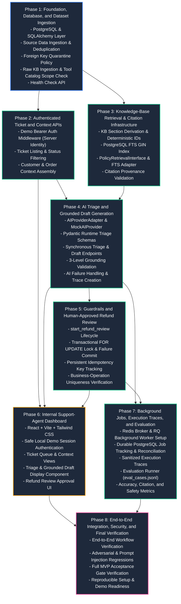

# TrustDesk — Phase-Wise Implementation Plan

**Document Version:** 1.1.0  
**Status:** Implementation Roadmap (Awaiting Approval)  
**Role:** Lead Backend Engineer, Software Architect & Technical Project Planner  
**Authoritative References:**  
1. [docs/problem_statement.md](file:///Users/dhruv/Desktop/TrustDesk/docs/problem_statement.md) (Product behavior, functional scope, and constraints)  
2. [docs/architecture.md](file:///Users/dhruv/Desktop/TrustDesk/docs/architecture.md) (Technical design, component boundaries, and schema specifications)  
3. [docs/unresolved.md](file:///Users/dhruv/Desktop/TrustDesk/docs/unresolved.md) (Living register of open decisions and dataset dependencies)

---

## 1. Plan Overview and Execution Principles

### 1.1 Purpose and Authority Hierarchy
This plan defines the step-by-step technical progression required to build the complete TrustDesk application from an empty repository to a fully verified, demonstration-ready Minimum Viable Product (MVP).

Implementation decisions must strictly adhere to the following hierarchy of authority:
1. `docs/problem_statement.md` defines **what** must be built, the exact scope boundaries, and the functional rules.
2. `docs/architecture.md` defines **how** components interact, database models, API contracts, guardrails, and technology selections.
3. `docs/unresolved.md` defines **open uncertainties and dataset dependencies** that must not be silently converted into arbitrary implementation choices.

If an ambiguity arises, the issue must be recorded in `docs/unresolved.md` and clarified rather than disguised with ad-hoc assumptions.

### 1.2 Architectural Boundaries and Out-of-Scope Constraints
The following constraints are non-negotiable throughout all implementation phases:
- **Application Context:** TrustDesk is strictly an internal support-agent decision tool, **never** a customer-facing conversational chatbot.
- **Controlled Actions:** `start_refund_review` is the **only** sensitive operational action in scope. It registers a formal review request in the workflow; it **never** transfers money or communicates with payment gateways. `create_replacement_order` is **strictly out of scope**.
- **Human Authority:** The AI acts strictly as an advisory co-pilot. No sensitive action may execute without explicit human approval by an authenticated support agent.
- **Temporal Policy Evaluation:** All return and warranty eligibility checks must be evaluated **as of `ticket.created_at`**, never the current system clock (`NOW()`).
- **Post-MVP Deferrals:** Qdrant vector retrieval, JWT/OIDC authentication platforms, and fine-grained enterprise RBAC are explicitly deferred to post-MVP. They must not be introduced into MVP phases.

### 1.3 Mandatory Phase Completion Workflow
Every phase must execute according to the following 11-step protocol:
1. **Review:** Read `problem_statement.md`, `architecture.md`, `implementation_plan.md`, and `unresolved.md`.
2. **Inspect:** Inspect existing code, database schemas, and newly supplied dataset files.
3. **Scope Confirmation:** Confirm the exact prerequisites, scope boundaries, and non-goals for the active phase.
4. **Implementation:** Write clean, modular code strictly within the phase scope.
5. **Testing:** Write and execute automated unit, integration, and security tests required by the phase.
6. **Edge Case Verification:** Systematically trigger and verify all phase-specific edge cases and failure modes.
7. **Acceptance Verification:** Evaluate deliverables against the explicit Markdown acceptance checklist.
8. **Defect Remediation:** Resolve all failing tests and discrepancies before marking the phase complete.
9. **Register Synchronization:** Update `docs/unresolved.md` by moving resolved items to the Resolved section with supporting evidence.
10. **Phase Completion Report:** Produce a concise completion report documenting implemented modules, executed tests, verification results, known limitations, and remaining unresolved dependencies.
11. **Approval Gate:** Stop and await user review and approval before beginning the next phase.

---

## 2. Phase Dependency and Sequencing Graph



---

## 3. Detailed Phase Specifications

---

### Phase 1 — Foundation, Database, and Dataset Ingestion

#### A. Objective
Establish the core Python/FastAPI project structure, local development environment with PostgreSQL 15, SQLAlchemy models for source entities, and an idempotent dataset ingestion pipeline that validates and persists raw customer, order, ticket, and knowledge base files while strictly distinguishing absent foreign keys from invalid references and preserving all original identifiers.

#### B. Prerequisites
- Docker and Docker Compose installed for local PostgreSQL 15+ containerization.
- Python 3.11+ environment configured.
- Source dataset files provided in `data/` (`customers.*`, `orders.*`, `tickets.*`, `kb_documents.*`, `tool_catalog.*`).

#### C. Implementation Scope
1. **Project Scaffolding:** Create the modular monolith directory structure (`trustdesk/core`, `trustdesk/models`, `trustdesk/api`, `trustdesk/services`).
2. **Environment & Configuration:** Implement `trustdesk/core/config.py` using `pydantic-settings` to manage environment variables (`DATABASE_URL`, `TRUSTDESK_DEMO_TOKEN`, `LOG_LEVEL`).
3. **Database Layer:** Configure SQLAlchemy 2.0 with PostgreSQL driver (`psycopg3` or `asyncpg`) and initialize Alembic for schema migrations.
4. **Source Database Models:** Define SQLAlchemy models for `customers`, `orders`, `tickets`, and `kb_documents` matching `docs/architecture.md` §4.3. Note that `kb_sections` derivation is deferred to Phase 3.
5. **Foreign Key Validation & Quarantine Policy:** Implement strict relational reference handling:
   - *Absent / Null Foreign Keys:* If a ticket naturally references no order (`order_id IS NULL`), store `order_id = NULL` (valid domain behavior).
   - *Invalid Non-Null Foreign Keys:* If a ticket references an `order_id` that does not exist in `orders`, **never silently discard the invalid reference**. The raw unresolvable string must be preserved in a structured metadata column (e.g., `tickets.raw_metadata["unresolved_order_id"] = "ORD-INVALID"`), while the relational column `order_id` is set to `NULL` to preserve relational integrity. A structured ingestion warning is logged.
   - *Mandatory Parent Missing:* If a mandatory parent entity is missing (e.g., an unresolvable `customer_id`), quarantine the record in an ingestion quarantine table or reject it with an explicit validation error, preventing orphaned tickets.
6. **Raw Knowledge Base Ingestion:** Ingest raw policy documents into `kb_documents` (`kb_id`, `title`, `category`, `raw_content`), preserving original document IDs (e.g., `KB-REFUND-001`, `KB-ADVERSARIAL-001`). Section derivation and FTS indexing belong strictly to Phase 3.
7. **Tool Catalog Ingestion & Scope Enforcement:** Ingest the tool catalog file. Inspect all defined tools and register them in an in-memory/database tool registry. The backend explicitly marks `start_refund_review` as the only supported operational action in scope, and marks any out-of-scope tools (e.g., `create_replacement_order`) as disabled/unsupported by backend policy (`U-013`).
8. **Health Check API:** Create `GET /api/v1/health` verifying database connectivity.
9. **Ingestion CLI:** Create an entrypoint command (`python -m trustdesk.cli ingest`) to run dataset loading.

#### D. Expected Deliverables
- `pyproject.toml` or `requirements.txt`: Project dependencies (`fastapi`, `uvicorn`, `sqlalchemy`, `alembic`, `pydantic`, `pydantic-settings`, `psycopg[binary]`, `pytest`).
- `docker-compose.yml`: Minimal infrastructure for PostgreSQL 15 (Redis is sequenced in Phase 7).
- `.env.example`: Template for local environment variables.
- `trustdesk/core/config.py`: Application settings.
- `trustdesk/core/database.py`: SQLAlchemy engine, session maker, and base model.
- `alembic/`: Migration environment and initial schema migration for source tables.
- `trustdesk/models/`: Source models (`customer.py`, `order.py`, `ticket.py`, `knowledge.py`).
- `trustdesk/services/ingestion.py`: Ingestion logic with deduplication, quarantine policy, and identifier preservation.
- `trustdesk/api/v1/health.py`: Health endpoint (`GET /api/v1/health`).
- `trustdesk/main.py`: FastAPI application entrypoint.

#### E. Required Tests
- `tests/unit/test_config.py`: Verify settings loading, defaults, and validation.
- `tests/integration/test_database.py`: Verify database session creation, table existence, and migrations.
- `tests/integration/test_ingestion.py`:
  - Verify ingestion of customer, order, ticket, and raw KB records.
  - Verify deduplication: re-running ingestion does not duplicate primary keys or alter existing records.
  - Verify identifier preservation: `kb_id` like `KB-REFUND-001` and `KB-ADVERSARIAL-001` match source files exactly.
  - Verify foreign key handling: ticket with absent `order_id` stores `order_id = NULL`.
  - Verify invalid reference quarantine: ticket with non-existent `order_id` preserves the raw string in `raw_metadata` and sets relational `order_id = NULL`.
  - Verify tool catalog enforcement: `start_refund_review` is enabled; `create_replacement_order` is marked unsupported.
- `tests/integration/test_health.py`: Verify `GET /api/v1/health` returns HTTP 200 and database status "healthy".

#### F. Edge Cases and Failure Scenarios
1. **Database Unreachable at Startup:**
   - *Condition:* PostgreSQL container is down or `DATABASE_URL` is invalid.
   - *Behavior:* Application fails fast with a clear connection error; `/api/v1/health` returns HTTP 503 Service Unavailable.
   - *Verification:* Integration test with invalid database URL.
2. **Ingestion Re-run (Idempotency):**
   - *Condition:* Ingestion command is executed twice consecutively on identical data.
   - *Behavior:* Second run completes with zero primary key collision errors; row counts remain identical.
   - *Verification:* Automated test executing `ingest_dataset()` twice and asserting table counts.
3. **Invalid Non-Null Foreign Key in Ingested Data:**
   - *Condition:* A ticket references `order_id = "ORD-MISSING-999"` that does not exist in the orders dataset.
   - *Behavior:* Ingestion does not discard the invalid string; it sets the relation `order_id = NULL`, stores `"unresolved_order_id": "ORD-MISSING-999"` in `raw_metadata`, and logs a structured warning.
   - *Verification:* Ingest ticket with invalid order ID and query database to assert metadata preservation.
4. **Tool Catalog Contains Unsupported Actions:**
   - *Condition:* Tool catalog contains `create_replacement_order` or financial refund disbursement tools.
   - *Behavior:* Tool registry records their presence but explicitly flags them as `supported: false` / `in_scope: false`.
   - *Verification:* Inspect tool registry and assert only `start_refund_review` is marked active.

#### G. Acceptance Criteria
- [ ] Docker Compose starts PostgreSQL 15 successfully.
- [ ] Alembic migrations run cleanly from scratch to `head`.
- [ ] Actual source dataset files in `data/` have been inspected and validated.
- [ ] `python -m trustdesk.cli ingest` loads all customers, orders, tickets, raw KB documents, and tool catalog entries.
- [ ] Running ingestion a second time produces identical database row counts without errors.
- [ ] All original identifiers (`customer_id`, `order_id`, `ticket_id`, `kb_id`) are preserved exactly.
- [ ] Invalid non-null foreign key references are quarantined in metadata without silent data discard.
- [ ] Tool catalog explicitly restricts active operational actions to `start_refund_review`.
- [ ] `GET /api/v1/health` returns `{"status": "healthy", "database": "connected"}`.
- [ ] All unit and integration tests pass with 100% success.

#### H. Verification Commands
```bash
# Planned verification commands
docker compose up -d postgres
alembic upgrade head
python -m trustdesk.cli ingest --data-dir ./data
pytest tests/unit tests/integration/test_database.py tests/integration/test_ingestion.py tests/integration/test_health.py
curl -f http://localhost:8000/api/v1/health
```

#### I. Out-of-Scope Work
- No KB section chunking or FTS vector calculation (strictly owned by Phase 3).
- No Redis broker or RQ worker containerization (strictly owned by Phase 7).
- No AI provider calls or mock AI providers (Phase 4).
- No React frontend code (Phase 6).
- No action execution or ticket triage (Phases 4 & 5).

#### J. Unresolved Decisions
- Reference `docs/unresolved.md`:
  - `U-003` (Source dataset schema): **Must be unblocked in this phase** by inspecting actual source files when provided.
  - `U-010` (Local dev setup): **Addressed in this phase** by establishing Docker Compose PostgreSQL baseline.
  - `U-013` (Tool catalog ingestion): **Addressed in this phase** by inspecting tool catalog format.

---

### Phase 2 — Authenticated Ticket and Context APIs

#### A. Objective
Build the deterministic backend APIs for support-ticket management, customer profile retrieval, and linked-order context assembly, protected by server-side demo bearer token authentication that maps to a verified internal agent identity.

#### B. Prerequisites
- Phase 1 complete and verified.
- Source customers, orders, and tickets persisted in PostgreSQL.

#### C. Implementation Scope
1. **Authentication Middleware & Server Identity Binding:**
   - Implement `trustdesk/core/security.py` with FastAPI dependency `verify_demo_token`.
   - Validate incoming `Authorization: Bearer <token>` against `TRUSTDESK_DEMO_TOKEN`.
   - Map valid tokens server-side to the fixed demo agent identity (`DEMO_AGENT_IDENTITY`).
   - Reject missing or invalid tokens with HTTP 401 Unauthorized. Clients cannot forge or override `agent_id`.
2. **Pydantic API Schemas:**
   - Create `trustdesk/schemas/ticket.py` with schemas for `TicketSummarySchema`, `TicketDetailSchema`, and `TicketContextSchema`.
3. **Ticket Service & Filtering Semantics:**
   - Implement `trustdesk/services/ticket_service.py` to query tickets.
   - *Filter Clarification:* Source tickets possess an operational status (`open`, `in_review`, `closed`), but **do not possess an AI-assigned issue category in the source dataset**. In Phase 2, `GET /api/v1/tickets` supports filtering on `status` and `customer_id`. Filtering by `category` is implemented via an outer join with `triage_results.category` once AI triage records exist in Phase 4.
4. **REST API Endpoints:**
   - `GET /api/v1/tickets`: List tickets with status filtering and pagination (`limit`, `offset`).
   - `GET /api/v1/tickets/{ticket_id}`: Retrieve single ticket detail.
   - `GET /api/v1/tickets/{ticket_id}/context`: Retrieve ticket context including linked customer, linked order details, and historical tickets.
5. **Standardized Error Handling:**
   - Implement global FastAPI exception handlers returning consistent JSON error payloads matching `docs/architecture.md` §5.4.

#### D. Expected Deliverables
- `trustdesk/core/security.py`: Token validation dependency and demo agent identity mapper.
- `trustdesk/schemas/ticket.py`: Pydantic request and response schemas.
- `trustdesk/services/ticket_service.py`: Context assembly and ticket query logic.
- `trustdesk/api/v1/tickets.py`: FastAPI router implementing ticket endpoints.
- `tests/integration/test_ticket_api.py`: Comprehensive API tests for authentication and context retrieval.

#### E. Required Tests
- `tests/unit/test_security.py`: Verify token validation (valid token passes, invalid/missing token raises HTTP 401).
- `tests/integration/test_ticket_api.py`:
  - Verify `GET /api/v1/tickets` requires auth and returns ticket list with total count.
  - Verify status filtering (`?status=open`) returns only matching tickets.
  - Verify `GET /api/v1/tickets/{id}` returns accurate ticket details.
  - Verify `GET /api/v1/tickets/{id}/context` returns customer profile, linked order (if present), and order items.
  - Verify ticket without an order (`order_id = NULL`) returns `context.order = null` without error.
  - Verify requesting non-existent `ticket_id` returns HTTP 404 Not Found.

#### F. Edge Cases and Failure Scenarios
1. **Unauthenticated Request:**
   - *Condition:* Client sends request without `Authorization` header or with incorrect token.
   - *Behavior:* API returns HTTP 401 Unauthorized with standard error payload: `{"error": {"code": "UNAUTHORIZED", "message": "..."}}`.
   - *Verification:* Test sending request with no header, empty header, and random string.
2. **Ticket Without Linked Order:**
   - *Condition:* Ticket exists with `order_id = NULL`.
   - *Behavior:* `/api/v1/tickets/{ticket_id}/context` returns HTTP 200 with customer data populated and `order: null`.
   - *Verification:* Query context for a ticket ingested with null order reference.
3. **Non-Existent Ticket ID:**
   - *Condition:* Client requests `GET /api/v1/tickets/NON-EXISTENT-ID`.
   - *Behavior:* API returns HTTP 404 Not Found with error code `TICKET_NOT_FOUND`.
   - *Verification:* Request dummy UUID/ID and assert HTTP 404.
4. **Agent Identity Tampering:**
   - *Condition:* Client attempts to pass custom `X-Agent-ID` header to override server identity.
   - *Behavior:* Backend ignores client-supplied agent headers and strictly uses server-bound `DEMO_AGENT_IDENTITY`.
   - *Verification:* Assert returned context and audit fields reflect server identity.

#### G. Acceptance Criteria
- [ ] All ticket endpoints require demo bearer token; unauthenticated calls return HTTP 401.
- [ ] `GET /api/v1/tickets` lists tickets with total count and supports pagination and status filtering.
- [ ] `GET /api/v1/tickets/{id}` returns full ticket detail.
- [ ] `GET /api/v1/tickets/{id}/context` returns linked customer and order history.
- [ ] Tickets without orders resolve cleanly with `order: null`.
- [ ] All error responses adhere to standard JSON error format.
- [ ] All unit and integration tests pass.

#### H. Verification Commands
```bash
# Planned verification commands
pytest tests/unit/test_security.py tests/integration/test_ticket_api.py
curl -H "Authorization: Bearer test_token" http://localhost:8000/api/v1/tickets
```

#### I. Out-of-Scope Work
- No AI triage or draft generation (Phase 4).
- No refund-review actions or approvals (Phase 5).
- No frontend dashboard components (Phase 6).
- No JWT/OIDC authentication (Post-MVP).

#### J. Unresolved Decisions
- Reference `docs/unresolved.md`:
  - `U-010` (Dev setup): Token configuration verified via `.env`.
  - `U-012` (Post-MVP auth): Confirmed demo bearer token is used; JWT/RBAC remains deferred.

---

### Phase 3 — Knowledge-Base Retrieval and Citation Infrastructure

#### A. Objective
Build the RAG retrieval foundation without requiring a live LLM by implementing policy document sectioning, PostgreSQL Full-Text Search (FTS) indexing, the `PolicyRetrievalInterface` abstraction, and citation provenance validation.

#### B. Prerequisites
- Phase 1 complete (raw knowledge base documents persisted in `kb_documents`).
- Core database models and migration framework established.

#### C. Implementation Scope
1. **Section Derivation & Indexing Migration (Phase 3 Ownership):**
   - Implement structural section chunking in `trustdesk/services/knowledge_service.py` based on markdown headers (`## Section Title`).
   - Populate `kb_sections` with deterministic IDs: `{kb_id}#sec-{index}`, preserving parent `kb_id`.
   - Add PostgreSQL GIN index on `kb_sections.search_vector` (`tsvector` generated from title weight 'A' and content weight 'B').
2. **Retrieval Abstraction Interface:**
   - Define `PolicyRetrievalInterface` ABC in `trustdesk/services/retrieval/base.py` with method:
     `search_policies(query: str, limit: int = 5) -> list[PolicySectionMatch]`.
3. **PostgreSQL FTS Implementation:**
   - Implement `PostgresFtsRetrievalAdapter` in `trustdesk/services/retrieval/postgres_fts.py`.
   - Execute text ranking using `plainto_tsquery('english', :query)` and `ts_rank_cd`.
   - Treat `limit=5` as a configurable default parameter, not a coverage guarantee.
   - Implement multi-intent query handling (merging and deduplicating section matches).
   - Do not invent arbitrary relevance cutoff thresholds before inspecting actual KB documents and evaluation data.
4. **Citation Provenance Validation Service:**
   - Implement `trustdesk/services/citation_service.py` with method:
     `validate_citation_provenance(cited_sections: list[CitationRef], retrieved_sections: list[PolicySectionMatch]) -> ProvenanceResult`.
   - Validates that every cited `kb_id` and `section_id` exists in the retrieved evidence set (`has_valid_provenance`).
5. **Insufficient Evidence Detection:**
   - Flag queries returning zero matches or empty evidence sets to signal required escalation.

#### D. Expected Deliverables
- Alembic migration creating `kb_sections` and GIN index `idx_kb_sections_fts`.
- `trustdesk/models/knowledge.py`: Update with `KBSection` SQLAlchemy model.
- `trustdesk/services/retrieval/base.py`: Abstract `PolicyRetrievalInterface` and `PolicySectionMatch` model.
- `trustdesk/services/retrieval/postgres_fts.py`: Native PostgreSQL FTS search implementation.
- `trustdesk/services/knowledge_service.py`: Section chunking and indexing logic.
- `trustdesk/services/citation_service.py`: Citation provenance validator.
- `tests/integration/test_retrieval.py`: Tests for policy search, ranking, multi-policy queries, and citation provenance.

#### E. Required Tests
- `tests/unit/test_knowledge_chunking.py`: Verify markdown header splitting produces correct `{kb_id}#sec-{index}` identifiers and preserves raw document IDs.
- `tests/integration/test_retrieval.py`:
  - Verify keyword search on policy terms (e.g., "refund window", "shipping delay") returns matching sections.
  - Verify multiple sections are returned for inquiries touching both shipping and refund topics.
  - Verify retrieval on adversarial document (`KB-ADVERSARIAL-001`) returns text as inert data without executing system commands.
- `tests/unit/test_citation_validation.py`:
  - Verify valid citations (all cited sections present in retrieved set) pass provenance validation (`has_valid_provenance = True`).
  - Verify hallucinated citations (citing a section ID not retrieved) fail provenance validation (`has_valid_provenance = False`).

#### F. Edge Cases and Failure Scenarios
1. **Zero Matching Policy Sections:**
   - *Condition:* Customer inquiry contains completely unrelated or obscure keywords (e.g., "how do I cook lasagna?").
   - *Behavior:* Retrieval returns empty list; citation service flags `insufficient_evidence = True`.
   - *Verification:* Execute search with nonsensical query and assert empty result list and escalation flag.
2. **Multi-Policy Inquiry:**
   - *Condition:* Ticket inquiry touches multiple issues (e.g., "My package arrived late and the item inside was damaged").
   - *Behavior:* Multi-intent retrieval merges results from both shipping and warranty policies, deduplicating overlapping sections.
   - *Verification:* Assert returned sections include sections from both `KB-SHIPPING` and `KB-WAR` or `KB-REFUND`.
3. **Citation Hallucination Detection:**
   - *Condition:* Input cites `KB-REFUND-001#sec-99` when only sections `#sec-0` and `#sec-1` were retrieved.
   - *Behavior:* Provenance validator flags citation as invalid; `has_valid_provenance` returns False.
   - *Verification:* Pass synthetic citations to `validate_citation_provenance` and assert validation failure.
4. **Adversarial KB Ingestion & Retrieval:**
   - *Condition:* `KB-ADVERSARIAL-001` matches search query.
   - *Behavior:* Content is returned strictly as inert text data; no system commands or secret disclosure mechanisms are triggered.
   - *Verification:* Query for adversarial keywords and verify returned object is a standard `PolicySectionMatch`.

#### G. Acceptance Criteria
- [ ] Phase 3 successfully derives `kb_sections` from `kb_documents` with deterministic IDs (`{kb_id}#sec-{index}`).
- [ ] PostgreSQL GIN index is active on `search_vector`.
- [ ] `PolicyRetrievalInterface` decouples retrieval from PostgreSQL FTS.
- [ ] Keyword queries for refund, shipping, and warranty return relevant policy sections with ranking scores.
- [ ] Citation provenance validation correctly identifies valid vs. hallucinated citations.
- [ ] Empty search results cleanly signal insufficient evidence.
- [ ] All unit and integration retrieval tests pass.

#### H. Verification Commands
```bash
# Planned verification commands
pytest tests/unit/test_knowledge_chunking.py tests/unit/test_citation_validation.py tests/integration/test_retrieval.py
python -m trustdesk.cli search-policies "refund window"
```

#### I. Out-of-Scope Work
- No Qdrant vector database or embedding generation.
- No live LLM prompt generation (Phase 4).
- No action execution or frontend UI.

#### J. Unresolved Decisions
- Reference `docs/unresolved.md`:
  - `U-005` (Policy rules): Reference dates and thresholds inspected from actual policies.
  - `U-007` (Retrieval parameters): FTS weights and chunking thresholds tuned and documented.
  - `U-011` (Post-MVP semantic retrieval): Qdrant remains strictly post-MVP.

---

### Phase 4 — AI Triage and Grounded Draft Generation

#### A. Objective
Integrate AI ticket classification and policy-grounded response draft generation using a provider-independent adapter, runtime Pydantic schema validation, a 3-level grounding model, deterministic temporal policy checks, sanitized execution traces, and robust handling of malformed outputs, timeouts, and provider outages.

#### B. Prerequisites
- Phase 2 complete (Ticket and context APIs functional).
- Phase 3 complete (Policy retrieval and citation provenance validation functional).

#### C. Implementation Scope
1. **AI Provider Adapter Boundary:**
   - Implement `AIProviderAdapter` ABC in `trustdesk/services/ai/base.py` with methods: `triage_ticket`, `generate_draft`, and `evaluate_action_recommendation`.
2. **Deterministic Mock Provider:**
   - Implement `MockAIProvider` in `trustdesk/services/ai/mock_provider.py` returning reproducible responses keyed to test cases and keyword patterns.
3. **Live AI Provider Adapter:**
   - Implement `LiveAIProvider` in `trustdesk/services/ai/live_provider.py` connecting to the selected production LLM provider (`U-006`).
   - Implement strict 15-second timeout and bounded retry with backoff.
4. **Runtime Pydantic Schema Validation:**
   - Create schemas in `trustdesk/schemas/triage.py` and `trustdesk/schemas/draft.py`.
   - Strict category enum: `shipping`, `refund`, `warranty`, `billing`, `account_security`, `general`.
   - Strict priority enum: `low`, `medium`, `high`, `urgent`.
   - Escalation flag: `needs_escalation: bool`.
5. **AI Failure & Fallback Handling:**
   - If an LLM times out (15s) or returns malformed output failing Pydantic validation:
     - The adapter catches the error and returns a fallback triage object: `category = 'general'`, `priority = 'medium'`, `needs_escalation = True`, `is_fallback = True`.
     - Logs sanitized diagnostics (latency, error code, model).
     - Explicitly marks fallback classifications as **AI failures** (excluded from successful prediction counts).
6. **Prompt Assembly & Structural Framing:**
   - Implement prompt construction in `trustdesk/services/draft_service.py` enclosing customer inquiry in `<untrusted_customer_message>` and retrieved evidence in `<policy_evidence>`.
   - Framing provides structure, but backend authorization remains the true enforcement gate against prompt injection.
7. **Action Recommendation Advisory Contract:**
   - Implement `evaluate_action_recommendation` in the adapter. It evaluates ticket context and retrieved policy evidence to return:
     `ActionRecommendationSchema(action_type="start_refund_review", should_recommend=bool, payload=dict, reasoning=str)`.
   - The model has ZERO execution rights; its output serves strictly as an advisory proposal for Phase 5.
8. **Three-Level Grounding Validation:**
   - *Level 1 (Provenance):* Verify that cited section IDs exist in the retrieved evidence set (`has_valid_provenance`).
   - *Level 2 (Claim Support):* Model synthesis of cited snippets.
   - *Level 3 (Deterministic Policy Fact Check):* Backend independently verifies structured policy claims against authoritative order data (e.g., verifying that stated return eligibility matches $\Delta t = \text{ticket.created\_at} - \text{order.reference\_event\_date}$).
   - *Critical Grounding Rule:* An order being ineligible for refund does **not** make a draft ungrounded; a draft that correctly explains ineligibility is 100% grounded. The check confirms that the draft's assertions match policy reality.
   - Set `is_grounded = True` if Level 1 and Level 3 pass. If evidence is missing or ambiguous, set `escalation_suggested = True`.
9. **Synchronous Endpoints & Persistence:**
   - `POST /api/v1/tickets/{ticket_id}/triage`: Synchronous AI classification.
   - `POST /api/v1/tickets/{ticket_id}/draft`: Synchronous RAG policy retrieval and cited draft generation.
   - Persist results in `triage_results`, `draft_responses`, and `draft_citations`.
   - Persist sanitized execution trace in `execution_traces` (strictly no raw prompts or customer PII).

#### D. Expected Deliverables
- `trustdesk/services/ai/base.py`: Provider adapter interface.
- `trustdesk/services/ai/mock_provider.py`: Deterministic test mock.
- `trustdesk/services/ai/live_provider.py`: Production LLM adapter.
- `trustdesk/schemas/triage.py` & `trustdesk/schemas/draft.py`: Pydantic models.
- `trustdesk/services/draft_service.py`: Prompt assembly, draft generation, and grounding validation.
- `trustdesk/api/v1/triage.py` & `trustdesk/api/v1/drafts.py`: REST routers.
- `alembic/`: Migrations for `triage_results`, `draft_responses`, `draft_citations`, and `execution_traces`.
- `tests/unit/test_triage_schemas.py` & `tests/integration/test_ai_workflows.py`.

#### E. Required Tests
- `tests/unit/test_triage_schemas.py`: Verify valid category/priority values parse; invalid values (e.g., `"security"` or `"critical"`) raise `ValidationError`.
- `tests/integration/test_ai_workflows.py`:
  - Test `POST /api/v1/tickets/{id}/triage` using `MockAIProvider` returns HTTP 200 with category, priority, and escalation flag.
  - Test `POST /api/v1/tickets/{id}/draft` retrieves policies, generates cited draft, and records citation records in PostgreSQL.
  - Test citation validation: drafts citing valid sections return `has_valid_provenance = True`.
  - Test grounded ineligibility: draft explaining customer ineligibility under policy rules is verified as `is_grounded = True`.
  - Test escalation behavior: ticket with no matching policy returns `escalation_suggested = True` and escalation message.
- `tests/unit/test_ai_failure_handling.py`:
  - Test provider timeout (simulated 15s delay) triggers fallback triage object with `needs_escalation = True` and `is_fallback = True`.
  - Test malformed JSON from provider triggers fallback triage object and records sanitized diagnostics.

#### F. Edge Cases and Failure Scenarios
1. **Malformed Output from LLM:**
   - *Condition:* LLM returns non-JSON or missing required Pydantic fields.
   - *Behavior:* Exception is caught; fallback triage object returned with `category='general'`, `priority='medium'`, `needs_escalation=True`, `is_fallback=True`; logged as AI failure.
   - *Verification:* Unit test injecting invalid JSON string into adapter.
2. **LLM Provider Timeout / Outage:**
   - *Condition:* External LLM API times out after 15 seconds.
   - *Behavior:* Single retry with backoff; if still failing, returns fallback triage or HTTP 504 with sanitized error; no raw secrets logged.
   - *Verification:* Test with mock provider raising timeout exception.
3. **Missing Policy Evidence for Inquiry:**
   - *Condition:* Customer asks about a topic not covered by any knowledge base document.
   - *Behavior:* Draft service detects zero retrieved sections; attaches escalation notice: *"Escalated to human supervisor: insufficient policy evidence"*; `escalation_suggested = True`.
   - *Verification:* Trigger draft generation for unindexed topic.
4. **Draft Claims Eligibility for Ineligible Customer:**
   - *Condition:* LLM hallucinates that an expired order is eligible for refund.
   - *Behavior:* Deterministic Level 3 check detects contradiction with policy dates; flags `is_grounded = False` and sets `escalation_suggested = True`.
   - *Verification:* Test draft generation fixture where model claims eligibility on expired order.

#### G. Acceptance Criteria
- [ ] All LLM calls route through `AIProviderAdapter`.
- [ ] `MockAIProvider` enables deterministic, offline test execution.
- [ ] Triage outputs strictly validate against permitted categories and priorities.
- [ ] Draft generation retrieves policy evidence, includes citations, and validates provenance.
- [ ] Deterministic temporal policy checks verify eligibility relative to `ticket.created_at`.
- [ ] Draft accurately explaining ineligibility is correctly recognized as grounded.
- [ ] Provider timeouts and malformed responses return explicit fallback classifications marked as AI failures.
- [ ] `evaluate_action_recommendation` provides advisory output only, with zero direct execution privileges.
- [ ] Triage, drafts, citations, and sanitized execution traces are persisted in PostgreSQL.
- [ ] All tests pass reliably.

#### H. Verification Commands
```bash
# Planned verification commands
pytest tests/unit/test_triage_schemas.py tests/unit/test_ai_failure_handling.py tests/integration/test_ai_workflows.py
curl -X POST -H "Authorization: Bearer test_token" http://localhost:8000/api/v1/tickets/TIK-001/triage
curl -X POST -H "Authorization: Bearer test_token" http://localhost:8000/api/v1/tickets/TIK-001/draft
```

#### I. Out-of-Scope Work
- No autonomous execution of sensitive actions by the AI.
- No replacement order creation.
- No asynchronous background queue processing (Phase 7).
- No frontend UI rendering (Phase 6).

#### J. Unresolved Decisions
- Reference `docs/unresolved.md`:
  - `U-002` (Draft grounding semantics): **Resolved in this phase** through 3-level validation model and ineligibility grounding clarification.
  - `U-006` (AI provider selection): **Addressed in this phase** by selecting live model and configuring credentials.

---

### Phase 5 — Guardrails and Human-Approved Refund Review

#### A. Objective
Implement the only sensitive operational action in TrustDesk (`start_refund_review`) under strict human-in-the-loop authorization, enforcing prompt-injection defenses, a coherent transactional execution/failure contract, persistent request idempotency, and confirmed business-operation uniqueness.

#### B. Prerequisites
- Phase 2 complete (authenticated ticket and context APIs).
- Phase 4 complete (AI recommendations and draft pipeline functional).

#### C. Implementation Scope
1. **Action Database Architecture:**
   - Create migrations for `proposed_actions` and `action_idempotency` matching `docs/architecture.md` §4.3 (Table 7).
   - Enforce canonical lifecycle: `pending_approval → rejected | executed | failed`.
   - Confirm and implement the business-operation unique constraint (`U-001`) to prevent multiple active reviews on a ticket.
2. **Action Recommendation Proposal Flow:**
   - Implement `POST /api/v1/tickets/{ticket_id}/actions/refund-review/propose`.
   - Connects Phase 4 `evaluate_action_recommendation` advisory output to create a pending proposal.
   - Persists action with status `pending_approval`.
   - Rejects proposal if an active review already exists on the ticket (`409 Conflict`).
3. **Approval and Rejection Endpoints:**
   - `POST /api/v1/actions/{action_id}/approve`: Authenticated agent approval triggering transactional execution.
   - `POST /api/v1/actions/{action_id}/reject`: Authenticated agent rejection transitioning status to `rejected`.
4. **Coherent Transactional Execution and Failure Contract:**
   - Implement transactional approval flow in `trustdesk/services/action_service.py` using `SELECT ... FOR UPDATE` on the action row:
     - *State Check:* Validate that current status is `pending_approval`.
     - *Business Failure Handling:* If a business rule check or downstream review registration fails, update `proposed_actions.status = 'failed'`, record error details, and **commit** the transaction so the failure audit is preserved.
     - *Database Error Handling:* If a transient database crash, connection drop, or deadlock occurs, the transaction **rolls back** cleanly, leaving the row in `pending_approval` for a subsequent retry.
     - *Retry Contract:* Define whether `failed` actions can be directly retried with a fresh idempotency key (`POST /api/v1/actions/{id}/approve`) or if proposing a new action is required (`U-008`).
5. **Idempotency Contract:**
   - Strictly distinguish the three request scenarios:
     1. *Identical-Key Replay:* Request arrives with existing `Idempotency-Key` and matching `request_hash`. Return cached `200 OK` with previous execution result without re-executing.
     2. *New Request Against Already-Processed Action:* Request arrives for an action row whose status is already `executed` or `rejected`. Return `409 Conflict` (`ACTION_ALREADY_PROCESSED`).
     3. *Key Reuse with Payload Tampering:* Same key used with different payload parameters. Return `409 Conflict` (`IDEMPOTENCY_KEY_REUSE_WITH_DIFFERENT_PAYLOAD`).
6. **Guardrail Defenses:**
   - Remove claims that delimiters prevent prompt injection. Backend authorization, lack of tool execution privileges, and human approval gates are the actual enforcement mechanisms.
   - Enforce that `start_refund_review` registers a formal review request and **never** initiates monetary payment processing.
   - Verify that adversarial knowledge document `KB-ADVERSARIAL-001` cannot bypass approval gates or trigger automated refunds.

#### D. Expected Deliverables
- Alembic migration creating `proposed_actions` and `action_idempotency`.
- `trustdesk/models/action.py`: Action and idempotency SQLAlchemy models.
- `trustdesk/schemas/action.py`: Pydantic schemas for action proposal, approval, rejection, and idempotency responses.
- `trustdesk/services/action_service.py`: Transactional approval logic with `FOR UPDATE` lock, failure commit, and idempotency checking.
- `trustdesk/api/v1/actions.py`: Router implementing `/propose`, `/approve`, and `/reject`.
- `tests/integration/test_action_approval.py`: Tests for approval, rejection, concurrency, and idempotency replay.
- `tests/adversarial/test_guardrails.py`: Tests verifying injection attacks cannot execute actions.

#### E. Required Tests
- `tests/integration/test_action_approval.py`:
  - Verify action proposal creates `pending_approval` state.
  - Verify agent approval transitions action to `executed` and records `reviewed_by`.
  - Verify agent rejection transitions action to `rejected`.
  - Verify identical-key replay returns cached 200 OK.
  - Verify already-executed or already-rejected action returns HTTP 409 Conflict when a new approval is attempted.
  - Verify key reuse with altered payload returns HTTP 409 Conflict.
  - Verify proposing a second review for the same ticket while one is active returns HTTP 409 Conflict.
- `tests/integration/test_concurrency.py`:
  - Simulate concurrent approval requests; verify exactly one commits `executed` and the second is handled safely (idempotent replay or 409).
- `tests/adversarial/test_guardrails.py`:
  - Submit tickets containing prompt injection; verify AI recommendation remains in `pending_approval` and cannot execute without human sign-off.
  - Verify `KB-ADVERSARIAL-001` cannot bypass the backend action gate.

#### F. Edge Cases and Failure Scenarios
1. **Concurrent Double-Click on Approval:**
   - *Condition:* Agent clicks "Approve" button twice simultaneously, triggering two identical HTTP requests.
   - *Behavior:* `SELECT ... FOR UPDATE` serializes requests. The first commits status `executed`; the second encounters completed idempotency key or non-pending status and returns HTTP 200 (idempotent replay) or HTTP 409 without double-execution.
   - *Verification:* Concurrent async test issuing simultaneous requests to `/approve`.
2. **Approval Attempt on Non-Pending Action:**
   - *Condition:* Agent attempts to approve an action that is already `rejected` or `executed`.
   - *Behavior:* API aborts transaction and returns HTTP 409 Conflict with `ACTION_ALREADY_PROCESSED`.
   - *Verification:* Call `/approve` sequentially twice with different keys.
3. **Execution Failure Preserves Audit State:**
   - *Condition:* Downstream review registration encounters business validation error during execution.
   - *Behavior:* Action updates status to `failed`, stamps error details, and commits the state change so audit history is preserved.
   - *Verification:* Test simulating execution failure and verifying row status in database.
4. **Transient Database Crash During Approval:**
   - *Condition:* Database connection terminates before commit.
   - *Behavior:* Transaction rolls back cleanly; action row remains in `pending_approval` for a subsequent retry.
   - *Verification:* Test simulating connection drop during lock acquisition.

#### G. Acceptance Criteria
- [ ] `start_refund_review` is the only operational action implemented; replacement orders are strictly excluded.
- [ ] An action recommendation always starts in `pending_approval` state.
- [ ] Action execution strictly requires authenticated human approval; AI cannot self-execute.
- [ ] Transactional `SELECT ... FOR UPDATE` prevents concurrent race conditions.
- [ ] Identical-key replay, already-processed action, and tampered key reuse are cleanly handled per contract.
- [ ] Business failures commit `status = 'failed'` to preserve audit state; transient DB errors roll back cleanly.
- [ ] Confirmed business-operation uniqueness constraint prevents duplicate active reviews per ticket (`U-001`).
- [ ] `reviewed_by` is stamped with the server-verified agent identity.
- [ ] All concurrency, idempotency, and adversarial tests pass.

#### H. Verification Commands
```bash
# Planned verification commands
pytest tests/integration/test_action_approval.py tests/integration/test_concurrency.py tests/adversarial/test_guardrails.py
curl -X POST -H "Authorization: Bearer test_token" http://localhost:8000/api/v1/tickets/TIK-001/actions/refund-review/propose
curl -X POST -H "Authorization: Bearer test_token" -H "Idempotency-Key: test-key-1" http://localhost:8000/api/v1/actions/{action_id}/approve
```

#### I. Out-of-Scope Work
- No payment processing, banking APIs, or fund transfers.
- No `create_replacement_order` action.
- No autonomous execution by AI models.

#### J. Unresolved Decisions
- Reference `docs/unresolved.md`:
  - `U-001` (Uniqueness key): **Resolved in this phase** by confirming business-operation identity before implementation.
  - `U-008` (Approval & retry contract): **Resolved in this phase** by formalizing terminal failure and retry contracts.

---

### Phase 6 — Internal Support-Agent Dashboard

#### A. Objective
Build the minimal internal support-agent web dashboard using React, Vite, and Tailwind CSS, allowing human support agents to browse tickets, inspect linked customer/order context, trigger AI triage, review grounded drafts and citations in a display-only viewer, and approve or reject refund-review recommendations using a safe local demo authentication arrangement.

#### B. Prerequisites
- Phase 2 complete (Ticket and context APIs).
- Phase 4 complete (Triage and draft generation APIs).
- Phase 5 complete (Action proposal, approval, and rejection APIs).

#### C. Implementation Scope
1. **Frontend Project Setup:**
   - Initialize Vite + React project in `frontend/` with Tailwind CSS.
2. **Safe Local Demo Session Authentication:**
   - **Never bundle or hardcode the backend bearer secret in client-side `.env` files** (`VITE_DEMO_TOKEN`).
   - Implement a minimal safe local-demo session arrangement:
     - The dashboard provides a top-bar Demo Session control / modal where the agent inputs or selects the demo bearer token.
     - The token is stored strictly in browser session memory (`sessionStorage`).
     - The API client dynamically attaches `Authorization: Bearer <token>` to requests.
3. **Core Dashboard Views:**
   - **Ticket Queue View:** Table displaying ticket list, status badges, categories, priorities, and creation timestamps with pagination.
   - **Ticket Detail & Context Panel:** Displays customer profile, linked order details, purchased items, and ticket conversation history.
   - **AI Triage Component:** Button to trigger triage, displaying category, priority badge, and escalation indicator.
   - **Grounded Draft & Citation Display (Display-Only):**
     - Per problem statement §3.6, the component is **display-only** for reviewing generated response drafts and inspecting citations. (No complex WYSIWYG editor or backend draft mutation CRUD).
     - Renders draft text, grounding status badge, and clickable policy citation chips showing `kb_id` and `section_id`.
     - Includes a "Copy to Clipboard" convenience button for the agent.
   - **Action Review Card:** Renders pending `start_refund_review` recommendation with order details, "Approve Review" and "Reject Review" buttons, and review notes input.
4. **UI States & Feedback:**
   - Implement loading spinners, error alerts, empty states, and disabled states during in-flight action execution.

#### D. Expected Deliverables
- `frontend/package.json`: Dependencies (`react`, `react-dom`, `vite`, `tailwindcss`).
- `frontend/src/api/client.js`: HTTP API client with dynamic auth interceptor.
- `frontend/src/components/`:
  - `TicketList.jsx`: Ticket queue with status filters.
  - `TicketContext.jsx`: Customer and order display.
  - `TriagePanel.jsx`: AI triage triggers and results.
  - `DraftViewer.jsx`: Display-only grounded draft display and citation chips with clipboard copy.
  - `ActionApprovalCard.jsx`: Human approval/rejection card.
  - `DemoSessionBar.jsx`: Safe local demo token input/session indicator.
- `frontend/src/App.jsx`: Main dashboard layout integrating views.
- `frontend/tests/`: Component rendering and interaction tests.

#### E. Required Tests
- `frontend/tests/TicketList.test.jsx`: Verify ticket queue renders items and status badges.
- `frontend/tests/TriagePanel.test.jsx`: Verify triage results display category, priority, and escalation alert.
- `frontend/tests/DraftViewer.test.jsx`: Verify display-only draft text and citation chips render; ungrounded drafts display escalation warning.
- `frontend/tests/ActionApprovalCard.test.jsx`:
  - Verify "Approve Review" button triggers API call and disables buttons during submission.
  - Verify error response (e.g., HTTP 409) displays alert to agent.
- `frontend/tests/DemoSessionBar.test.jsx`: Verify session token is held in memory/sessionStorage and not leaked.

#### F. Edge Cases and Failure Scenarios
1. **API Server Offline:**
   - *Condition:* Backend API is unreachable or returns 500.
   - *Behavior:* Dashboard displays global error banner: *"Unable to connect to TrustDesk backend. Check server status."*; no unhandled white-screen crashes.
   - *Verification:* Mock API network failure in frontend test.
2. **Unauthorized Session (401 Unauthorized):**
   - *Condition:* Demo bearer token is invalid or missing.
   - *Behavior:* UI displays authentication modal prompting for valid demo token.
   - *Verification:* Trigger API call with invalid token.
3. **Draft with Escalation Notice:**
   - *Condition:* Backend returns `escalation_suggested = True` due to missing policy evidence.
   - *Behavior:* UI displays prominent amber warning badge: *"Supervisor Review Required: Insufficient Policy Grounding"*.
   - *Verification:* Render mock response with escalation flag set.
4. **Action Already Processed (409 Conflict):**
   - *Condition:* Another agent or window already processed the refund review.
   - *Behavior:* Approval card catches 409 Conflict, updates status to "Already Processed", and disables action buttons.
   - *Verification:* Simulate 409 response on approval submission.

#### G. Acceptance Criteria
- [ ] Frontend builds cleanly with Vite and Tailwind CSS.
- [ ] Demo bearer token is not exposed in static browser bundle code.
- [ ] Support agents can browse tickets and inspect customer/order context.
- [ ] AI triage can be triggered and displays category, priority, and escalation flags.
- [ ] Grounded response drafts render in a display-only viewer with policy citation chips.
- [ ] Pending refund review can be approved or rejected through the interface.
- [ ] Action buttons prevent multiple submissions while loading.
- [ ] Error states and escalation warnings are visually clear.
- [ ] No customer-facing chatbot widgets or unrelated features are included.

#### H. Verification Commands
```bash
# Planned verification commands
cd frontend && npm install && npm run build
npm test
npm run dev
```

#### I. Out-of-Scope Work
- No customer-facing chat widget or public portal.
- No agent-to-agent internal chat or messaging.
- No draft mutation / WYSIWYG editor CRUD endpoints.
- No payment gateway integrations.

#### J. Unresolved Decisions
- Reference `docs/unresolved.md`:
  - `U-002` (Grounding semantics): UI renders `has_valid_provenance` and `escalation_suggested` badges.

---

### Phase 7 — Background Jobs, Execution Traces, and Evaluation

#### A. Objective
Implement asynchronous background processing using Redis and RQ for long-running batch evaluation suites and batch ticket processing, configure durable PostgreSQL job tracking with failure reconciliation for interrupted workers, persist immutable sanitized execution traces in PostgreSQL, and build the evaluation runner to benchmark system behavior against `data/eval_cases.jsonl`.

#### B. Prerequisites
- Phase 1 complete (PostgreSQL database models).
- Phase 4 complete (AI triage and draft services).
- Phase 5 complete (Action guardrails and traces).

#### C. Implementation Scope
1. **Infrastructure Sequencing (Phase 7 Ownership):**
   - Add Redis 7 container to `docker-compose.yml`.
   - Configure Redis connection in `trustdesk/core/redis.py`.
   - Implement RQ task definitions in `trustdesk/worker/tasks.py`.
   - Create RQ worker daemon entrypoint in `trustdesk/worker/worker.py`.
2. **Durable Job Tracking & Interrupted Worker Reconciliation:**
   - PostgreSQL `eval_runs` table is the authoritative durable state (`queued`, `running`, `completed`, `failed`). Redis is an ephemeral broker.
   - Enqueue evaluation runs via `POST /api/v1/evaluations/run` returning `job_id` and `run_id` (HTTP 202 Accepted).
   - Implement job status endpoint `GET /api/v1/jobs/{job_id}`.
   - *Failure Reconciliation:* At worker startup or periodic sweep, the system checks for `eval_runs` records in `running` status whose Redis jobs are no longer active in RQ queues or registries, marking them `failed` with reason `"worker_interrupted"`.
3. **Execution Trace Persistence Alignment:**
   - Align Phase 7 background worker traces with Phase 4 API traces: both record immutable records to `execution_traces`.
   - Schema fields: `ticket_id`, `run_type` (`triage`, `draft_generation`, `action_evaluation`, `evaluation_suite`), `retrieved_kb_ids`, `proposed_actions`, `executed_actions`, `guardrail_outcome` (`passed`, `flagged_injection`, `unsupported_claim`, `redacted`, `escalated`), `final_status` (`success`, `failed`, `escalated`), and `sanitized_telemetry`.
   - Redact customer PII and omit raw prompts from stored traces.
4. **Evaluation Runner & Dataset Contract (`U-004`, `U-009`):**
   - Implement `trustdesk/eval/runner.py` capable of execution via CLI (`python -m trustdesk.eval.runner`) or background worker.
   - Ingest and validate test cases from `data/eval_cases.jsonl`.
   - *Missing-Label Handling:* Cases missing expected ground-truth labels are marked `inconclusive`, excluded from the accuracy denominator, and reported under an inconclusive count.
   - *Failed-Model-Call Handling:* Model timeouts, malformed outputs, or network failures are included in the denominator and scored as 0 (failure).
   - *Scoring Formulas:*
     - Triage Accuracy = $\frac{\text{Cases where Category and Priority match Ground Truth}}{\text{Evaluatable Cases with Valid Ground Truth}}$.
     - Citation Validity = $\frac{\text{Drafts citing Ground-Truth KB IDs with Valid Provenance}}{\text{Cases Expecting Citations}}$.
     - Unsafe-Action Blocking = $\frac{\text{Adversarial Cases where Unauthorized Actions Were Blocked}}{\text{Total Adversarial Cases}}$.
     - Escalation Behavior = Precision and recall on cases flagged with `needs_escalation = True`.
   - Persist run results in `eval_runs` and individual case results in `eval_results`.
5. **Evaluation APIs:**
   - `GET /api/v1/evaluations`: List historical evaluation runs.
   - `GET /api/v1/evaluations/{run_id}`: Retrieve detailed run metrics and per-case results.
6. **Frontend Evaluation Display:**
   - Add minimal evaluation summary tab in agent dashboard to inspect run metrics, inconclusive counts, and failure breakdowns.

#### D. Expected Deliverables
- Updated `docker-compose.yml` adding Redis 7.
- `trustdesk/core/redis.py`: Redis client configuration.
- `trustdesk/worker/tasks.py`: Background job definitions (evaluation runner, batch processing).
- `trustdesk/worker/worker.py`: RQ worker execution entrypoint with interrupted worker reconciliation.
- `trustdesk/eval/runner.py`: Evaluation suite execution and metric calculation engine.
- `trustdesk/api/v1/jobs.py` & `trustdesk/api/v1/evaluations.py`: REST routers.
- `alembic/`: Migrations for `eval_runs` and `eval_results`.
- `tests/integration/test_worker.py`: Background job queuing, failure reconciliation, and status polling tests.
- `tests/integration/test_evaluation_runner.py`: Evaluation runner execution and metric computation tests.

#### E. Required Tests
- `tests/integration/test_worker.py`:
  - Verify job submission returns HTTP 202 with `job_id` and `run_id`.
  - Verify worker picks up job, executes task, and updates status to `completed`.
  - Verify task failure updates database record to `failed` with error diagnostics.
  - Verify reconciliation: orphaned `running` job is reconciled to `failed` upon restart.
- `tests/integration/test_evaluation_runner.py`:
  - Run evaluation suite on synthetic test cases using `MockAIProvider`.
  - Verify triage accuracy, citation validity, and safety blocking metrics calculate accurately.
  - Verify cases with missing labels are flagged as inconclusive and excluded from the denominator.
  - Verify failed model calls are counted as failures in the denominator.
  - Verify fallback AI classifications are counted as failures, not successes.
- `tests/unit/test_execution_traces.py`:
  - Verify trace records contain required fields and customer PII is masked.

#### F. Edge Cases and Failure Scenarios
1. **Worker Crash Mid-Execution:**
   - *Condition:* RQ worker process terminates unexpectedly while processing an evaluation run.
   - *Behavior:* Redis job state is lost; on startup/sweep, system detects orphaned `eval_runs` with status `running` and marks them `failed` with reason `"worker_interrupted"`.
   - *Verification:* Kill worker process during execution and verify database reconciliation.
2. **Evaluation Case with Missing Expected Labels:**
   - *Condition:* Case in `eval_cases.jsonl` lacks expected citation or category.
   - *Behavior:* Runner marks case as `inconclusive`, excludes it from accuracy denominator, and reports it in the summary without crashing the suite.
   - *Verification:* Run evaluation against fixture with incomplete ground truth.
3. **Redis Broker Temporarily Offline:**
   - *Condition:* Redis container is unreachable when `POST /api/v1/evaluations/run` is called.
   - *Behavior:* API returns HTTP 503 Service Unavailable with descriptive message; no orphaned `eval_runs` records left in database.
   - *Verification:* Stop Redis container and trigger evaluation endpoint.
4. **Adversarial Evaluation Case Handling:**
   - *Condition:* Case contains prompt injection attempting to trigger automated action.
   - *Behavior:* Evaluator confirms action was blocked; records `safety_passed = True`.
   - *Verification:* Run evaluation on adversarial fixture case.

#### G. Acceptance Criteria
- [ ] Redis and RQ worker daemon run cleanly and handle asynchronous tasks.
- [ ] `POST /api/v1/evaluations/run` enqueues job and returns `job_id` and `run_id`.
- [ ] Interrupted workers are safely reconciled, marking orphaned runs `failed`.
- [ ] Background worker processes `data/eval_cases.jsonl` and writes results to PostgreSQL.
- [ ] Inconclusive cases and failed model calls are mathematically handled per metric contract.
- [ ] Sanitized execution traces are persisted for all AI runs without PII leakage.
- [ ] Historical evaluation runs and metrics can be queried via API and viewed in dashboard.
- [ ] All worker and evaluation tests pass.

#### H. Verification Commands
```bash
# Planned verification commands
docker compose up -d redis
python -m trustdesk.worker.worker &
python -m trustdesk.eval.runner --eval-file ./data/eval_cases.jsonl
pytest tests/integration/test_worker.py tests/integration/test_evaluation_runner.py tests/unit/test_execution_traces.py
curl -H "Authorization: Bearer test_token" http://localhost:8000/api/v1/evaluations
```

#### I. Out-of-Scope Work
- No distributed Celery or Temporal orchestrators.
- No automatic LLM fine-tuning loops.
- No public webhooks or notification pipelines.

#### J. Unresolved Decisions
- Reference `docs/unresolved.md`:
  - `U-004` (Eval dataset contract): **Unblocked in this phase** when `data/eval_cases.jsonl` is inspected.
  - `U-009` (Metric formulas): **Resolved in this phase** by implementing formal scoring equations.

---

### Phase 8 — End-to-End Integration, Security, and Final Verification

#### A. Objective
Perform exhaustive end-to-end workflow verification, adversarial security regression testing, performance validation, and documentation alignment across the completed TrustDesk MVP to ensure demonstration readiness and full compliance with `docs/problem_statement.md` and `docs/architecture.md`.

#### B. Prerequisites
- Phases 1 through 7 complete, integrated, and individually verified.
- Complete application running in local development environment.

#### C. Implementation Scope
1. **Full End-to-End Workflow Verification:**
   - Verify all 4 canonical workflows defined in `docs/architecture.md` §12:
     - Workflow 1: Ticket Ingestion and AI Triage.
     - Workflow 2: RAG Policy Retrieval & Grounded Draft Generation.
     - Workflow 3: Refund-Review Recommendation, Human Approval, and Execution.
     - Workflow 4: Background Evaluation Suite Execution.
2. **Mandatory Acceptance Criteria Enforcement:**
   - Require all mandatory MVP acceptance criteria to pass. Documented non-blocking operational limitations (e.g., edge cases where source data lacks delivery date leading to expected escalation) are permitted, but no open mandatory requirements can be treated as complete.
3. **Adversarial & Security Regression Suite:**
   - Execute tests verifying prompt injection defenses across customer messages and retrieved policies.
   - Verify `KB-ADVERSARIAL-001` cannot bypass human approval or disclose system instructions.
   - Verify unauthenticated requests are rejected across all protected endpoints.
   - Verify idempotency keys and concurrency locks prevent duplicate refund reviews.
4. **Evaluation Benchmark Run:**
   - Execute full evaluation runner on `data/eval_cases.jsonl` using both `MockAIProvider` and live provider.
   - Generate evaluation report summarizing triage accuracy, citation validity, and safety blocking.
5. **Documentation & Demonstration Readiness:**
   - Verify `README.md` contains exact, reproducible setup, migration, and startup commands.
   - Update `docs/unresolved.md` moving all resolved MVP items to the Resolved section.
   - Document any known operational limitations and post-MVP upgrade paths.

#### D. Expected Deliverables
- `tests/e2e/test_complete_workflows.py`: End-to-end integration test suite.
- `tests/adversarial/test_security_regressions.py`: Comprehensive security regression suite.
- `README.md`: Complete setup, configuration, execution, and testing guide.
- `docs/unresolved.md`: Updated living register reflecting all resolved MVP items.
- Evaluation run summary report (`eval_report.json` / dashboard export).

#### E. Required Tests
- `tests/e2e/test_complete_workflows.py`:
  - Full happy path: Ingest ticket -> Triage -> Retrieve policies -> Generate grounded draft with citations -> Recommend refund review -> Authenticated agent approves review -> Verify database state and trace.
  - Escalation path: Ingest out-of-scope ticket -> Generate draft -> Verify escalation notice is generated and no action is executed.
- `tests/adversarial/test_security_regressions.py`:
  - Injection attacks attempting to trigger automated refunds.
  - Verification bypass attacks attempting password overrides.
  - Secret disclosure attacks attempting prompt extraction.
  - Concurrent approval attacks asserting strict serial execution.

#### F. Edge Cases and Failure Scenarios
1. **Full Pipeline Regression Failure:**
   - *Condition:* A change in retrieval chunking breaks citation validation in draft generation.
   - *Behavior:* End-to-end test catches regression; provenance failure flags ungrounded draft.
   - *Verification:* Execute complete E2E test suite.
2. **Adversarial KB Ingestion & Evaluation:**
   - *Condition:* Evaluation suite processes test case linked to `KB-ADVERSARIAL-001`.
   - *Behavior:* Guardrails prevent unauthorized actions; evaluation runner reports safety check passed.
   - *Verification:* Assert safety metric reaches 100% on adversarial eval cases.
3. **Cold System Startup from Clean State:**
   - *Condition:* Repository cloned onto fresh environment; Docker containers started; migrations run; data ingested.
   - *Behavior:* Application starts cleanly with zero manual database interventions; tests pass immediately.
   - *Verification:* Execute clean setup verification script.

#### G. Acceptance Criteria
- [ ] All 4 end-to-end workflows execute successfully without manual database edits.
- [ ] All unit, integration, adversarial, and E2E tests pass.
- [ ] All mandatory MVP acceptance criteria pass; documented non-blocking limitations are explicitly recorded.
- [ ] Adversarial security regressions confirm prompt injection and unauthorized actions are blocked.
- [ ] Action execution cannot occur without authenticated human approval.
- [ ] Evaluation runner executes to completion and produces valid metrics.
- [ ] `docs/unresolved.md` is updated; all MVP items resolved or explicitly tracked.
- [ ] `README.md` allows a new developer to set up, run, and test the project reproducibly.
- [ ] System is demonstration-ready.

#### H. Verification Commands
```bash
# Planned full system verification commands
docker compose up -d
alembic upgrade head
python -m trustdesk.cli ingest --data-dir ./data
pytest tests/
python -m trustdesk.eval.runner --eval-file ./data/eval_cases.jsonl
cd frontend && npm run build
```

#### I. Out-of-Scope Work
- No introduction of new functional features.
- No post-MVP enhancements (Qdrant, JWT/RBAC).

#### J. Unresolved Decisions
- Reference `docs/unresolved.md`:
  - Verify all MVP items (`U-001` through `U-010`, `U-013`) are marked **Resolved** with documented evidence.
  - Confirm `U-011` (Qdrant) and `U-012` (JWT/RBAC) remain explicitly **Deferred to Post-MVP**.

---

## 4. Traceability Matrix: Requirements to Phases

The following matrix maps every requirement from `docs/problem_statement.md` to its implementing and verifying phase:

| Problem Statement Section | Requirement Summary | Primary Implementation Phase | Verification & Testing Phase |
|---|---|:---:|:---:|
| **§1, §2** | Internal support-agent tool; human-in-the-loop decision support | Phase 2, Phase 6 | Phase 8 |
| **§3.1** | Data ingestion (customers, orders, tickets, raw KB, tool catalog) | Phase 1 | Phase 1, Phase 8 |
| **§3.1** | Original identifier preservation (`KB-REFUND-001`, `KB-ADVERSARIAL-001`) | Phase 1, Phase 3 | Phase 1, Phase 3 |
| **§3.1** | Temporal policy evaluation window ($\Delta t$ vs. `ticket.created_at`) | Phase 1, Phase 4 | Phase 4, Phase 5 |
| **§3.2** | Authenticated REST APIs for tickets, context, triage, drafts, actions | Phase 2, Phase 4, Phase 5 | Phase 2, Phase 8 |
| **§3.3** | AI triage: exact categories, priorities, escalation flag, runtime schema | Phase 4 | Phase 4, Phase 7 |
| **§3.4** | Policy retrieval abstraction (`PolicyRetrievalInterface`) & FTS | Phase 3 | Phase 3, Phase 8 |
| **§3.4** | Cited draft generation, citation validation, insufficient evidence escalation | Phase 4 | Phase 4, Phase 7 |
| **§3.5** | Guardrails against prompt injection, verification bypass, discount claims | Phase 5 | Phase 5, Phase 8 |
| **§3.5** | Single sensitive action: `start_refund_review` (human approval, idempotency) | Phase 5 | Phase 5, Phase 8 |
| **§3.5** | Prohibition of `create_replacement_order` and money disbursement | Phase 5 | Phase 5, Phase 8 |
| **§3.6** | Internal support-agent dashboard (React + Tailwind CSS, display-only draft viewer) | Phase 6 | Phase 6, Phase 8 |
| **§3.7** | Background jobs via Redis + RQ worker without blocking API | Phase 7 | Phase 7, Phase 8 |
| **§3.7** | Sanitized execution traces in PostgreSQL (no raw PII/secrets) | Phase 4, Phase 7 | Phase 7, Phase 8 |
| **§3.8** | Automated tests (pytest), mock AI provider, adversarial tests | Phase 1–5 | Phase 8 |
| **§3.8** | Evaluation runner (`data/eval_cases.jsonl`) measuring accuracy, citations, safety | Phase 7 | Phase 7, Phase 8 |
| **§4** | PostgreSQL primary DB, FTS retrieval, Redis/RQ background worker | Phase 1, Phase 3, Phase 7 | Phase 8 |
| **§4** | Deferred enhancements (Qdrant semantic search, JWT/RBAC) | Post-MVP (Tracked in `unresolved.md`) | Post-MVP |
| **§6, §7** | Reproducible setup, execution documentation, demonstration readiness | Phase 8 | Phase 8 |

---

## 5. Risk Register and Mitigation Strategy

| Risk ID | Identified Risk | Impact | Planned Mitigation in Plan |
|---|---|---|---|
| **R-1** | Source dataset files in `data/` deviate from proposed schema | High | Phase 1 explicitly mandates schema inspection before finalizing migrations; unverified fields are labeled provisional (`U-003`). |
| **R-2** | Commercial LLM rate limits or network outages during testing | Medium | Phase 4 implements `MockAIProvider` for all automated tests, ensuring deterministic, offline, zero-cost CI execution. |
| **R-3** | Concurrent approval requests create duplicate refund reviews | Critical | Phase 5 implements PostgreSQL `SELECT ... FOR UPDATE` row locks, persistent request idempotency, and confirmed business-operation uniqueness (`U-001`, `U-008`). |
| **R-4** | Prompt injection tricks model into claiming unauthorized actions | Critical | Phase 5 enforces that the AI has zero tool-execution privileges; all actions require human approval and backend authorization gates. |
| **R-5** | Long evaluation runs block interactive API requests | Medium | Phase 7 isolates evaluation runs inside a separate background Python RQ worker process. |
| **R-6** | Policy eligibility dates fail due to passage of real-world time | High | All policy calculations strictly evaluate elapsed time relative to `ticket.created_at`, prohibiting system clock (`NOW()`). |
| **R-7** | Worker process terminates unexpectedly during batch evaluation | Medium | Phase 7 implements interrupted worker reconciliation, safely updating orphaned runs to `failed` upon startup. |
